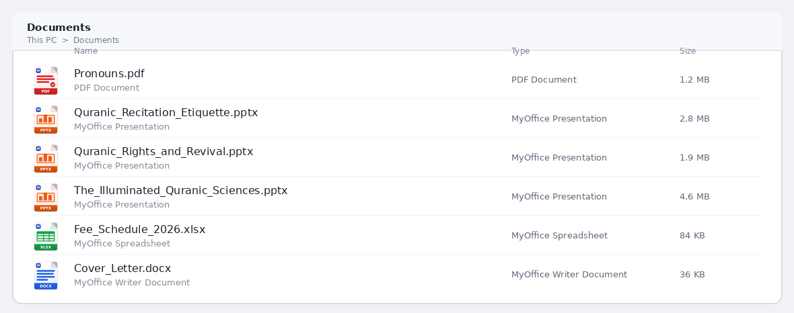

# MyOffice — Full Offline Windows & Android Office Suite

**MyOffice** is a standalone, privacy-first, cross-platform productivity suite for **Windows 10/11 (`PySide6 / Qt6`)** and **Android 8–15 (`Native Kotlin + Edge-to-Edge Studio`)** featuring full offline compatibility across **DOCX, XLSX, PPTX, PDF, OCR, Hardware-Bound Encrypted `.movault` Storage, Two-Way PC ↔ Phone Sync, Live Real-Time LAN Collaboration + Team Chat, and Cryptographically Signed Dual-Tier Over-The-Air (OTA) Updates**.

---

## Dual-Tier Cryptographically Signed Self-Update Architecture (`myoffice-ota-v2`)

Every release published to this repository is signed with **ECDSA P-256 + SHA-256** (`ota/manifest.json`) and verified against the pinned release public key embedded inside both native binaries:

1. **Tier 1 — Instant Signed Delta Hot-Patch (`< 1 second`, `0` compile time):**
   - **Android (`ota/android-ui.zip`, `~49 KB`):** Atomically swaps the entire mobile UI, spreadsheet formula engine, multi-touch gesture physics, Writer/Sheet/Presentation/PDF studio views, and theme system inside `filesDir/ota/active/ui/` with a **Native 4.5s Boot Watchdog + Automatic Rollback**.
   - **Windows (`ota/windows-patch.zip`, `~692 KB`):** Overrides frozen PyInstaller `app.*` packages via `OtaHotpatchFinder` at `sys.meta_path[0]` with **Boot Crash-Counter Watchdog + Automatic Rollback**.
2. **Tier 2 — Cloud Native Binary Builds (`GitHub Actions`):**
   - Pushing any `v*` tag compiles, tests, signs, and publishes native **`MyOffice_Android.apk`** (`ubuntu-latest`) and **`MyOffice_Setup.exe`** (`windows-latest` + Inno Setup 6) directly to **GitHub Releases**.

---

## Repository Structure

| Path | Description |
| :--- | :--- |
| `my-office-suite/` | Desktop Windows/Linux application (`Python 3.11`, `PySide6`, Writer, Sheet, Presentation, PDF Studio, OCR, `.movault`, Sync, Live Collaboration) |
| `my-office-android/` | Native Android application (`Kotlin`, `SDK 35`, Android 15 Edge-to-Edge, Apache POI OOXML, PdfBox, Two-Way Sync, Live Collab, `OtaUpdateManager`) |
| `ota-system/` | ECDSA P-256 release publisher CLI (`publish_release.py`) & pinned SPKI public key (`ota_public_key.b64`) |
| `ota/` | Live signed OTA channel (`manifest.json`, `android-ui.zip`, `windows-patch.zip`) |
| `.github/workflows/release-suite.yml` | Automated OTA signature verifier + Cloud Android APK & Windows Setup EXE release pipeline |

---

## What is new in `v1.6.3` — MyOffice-branded, unmistakable file-type icons (Windows)

Every file type now carries the **MyOffice brand mark** (blue "M" letterhead) *and* its own identity, so a PDF, a
DOCX, an XLSX and a PPTX can never be confused in Windows Explorer:

| Format | Icon | Band label | Glyph |
| :-- | :-- | :-- | :-- |
| Writer (`.docx`, `.docm`, `.dotx`, `.doc`, `.odt`, `.rtf`, `.wpt`) | blue page | `DOCX` | text lines |
| Spreadsheets (`.xlsx`, `.xlsm`, `.xltx`, `.xls`, `.csv`, `.ods`, `.tsv`, `.ett`) | green page | `XLSX` | spreadsheet grid |
| Presentation (`.pptx`, `.ppsx`, `.potx`, `.ppt`, `.odp`, `.dpt`) | orange page | `PPTX` | bar chart |
| PDF (`.pdf`) | red page | `PDF` | text block + verified seal |
| Photos (`.png`, `.jpg`, `.webp`, `.bmp`, `.gif`, `.tif`, `.jfif`) | violet page | `IMG` | photo montage |
| Code / text | teal page | `CODE` | angle brackets |
| `.movault` vault | slate page | `LOCK` | padlock |

* **10 resolutions per icon** (16, 20, 24, 32, 40, 48, 64, 96, 128, 256 px); the 16/20/24 px frames are a compact
  colour tile with a thick white glyph, because a 6 px tall text label is unreadable in Explorer's small views.
* **Icon mirror + cache busting:** artwork is mirrored into `%APPDATA%\MyOffice\icons\<kind>-<version>.ico` and every
  `DefaultIcon` points there. The version in the file name busts Explorer's path-keyed icon cache, so an update shows
  the new picture immediately - no reinstall, no log-off, no manual icon-cache purge.
* **`Tools -> Refresh File Type Icons`** re-points all ProgIDs and rebuilds the shell icon cache on demand.
* A signed OTA hot-patch (`ota/windows-patch.zip`, ~1.1 MB) now ships the artwork too, so existing `v1.6.2` installs
  receive the new icons without downloading the 116 MB setup.
