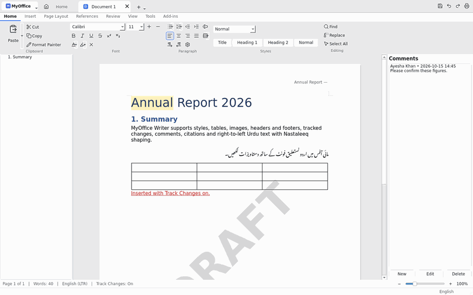
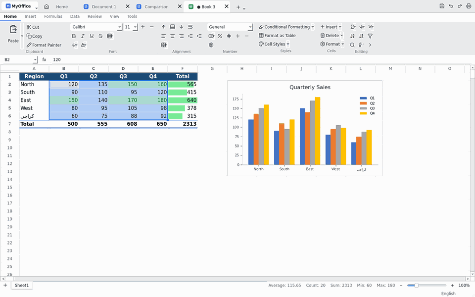
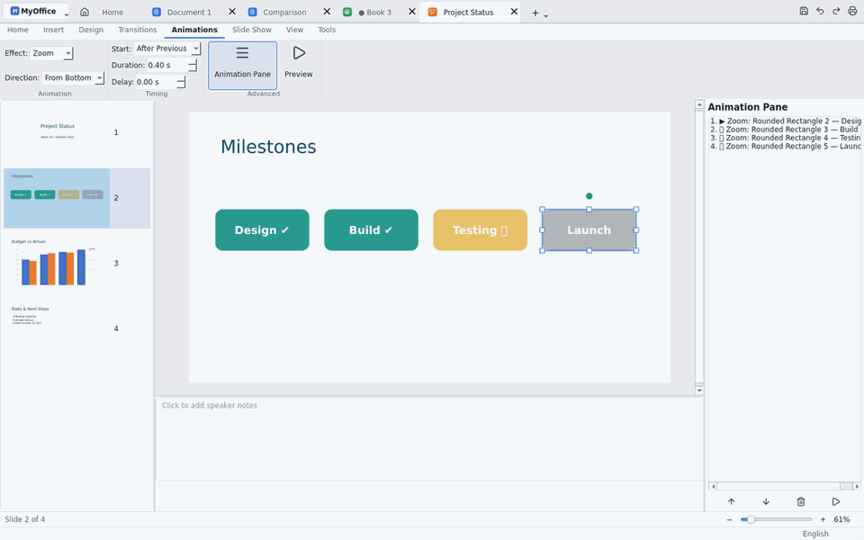
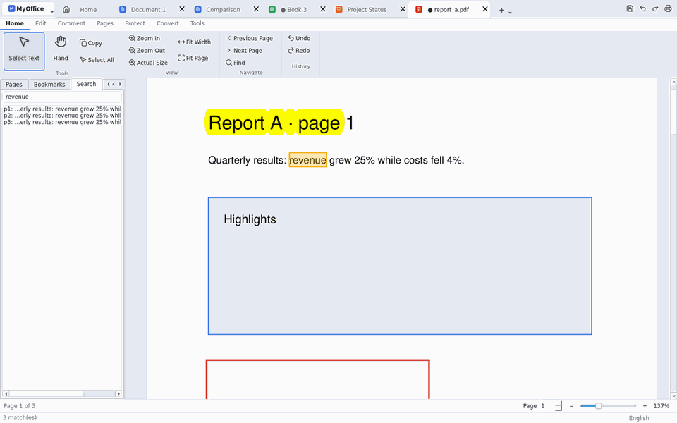
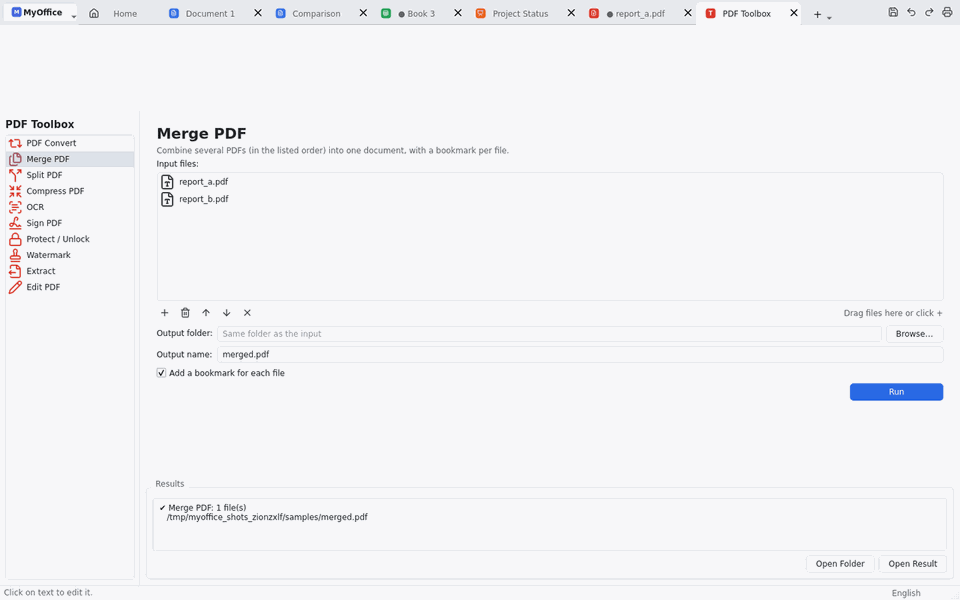
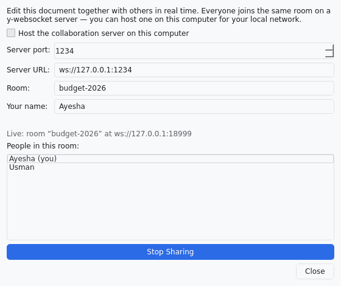
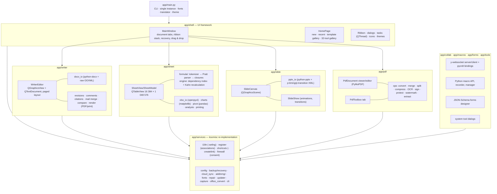

# MyOffice

**MyOffice** is a desktop office suite written in Python 3.11+ and Qt 6 (PySide6). It has a WPS-style tabbed
interface and 48 integrated tools:

- **Writer** for word processing, **Spreadsheets** with its own formula engine (456 functions), **Presentation**
  with animations, a **PDF viewer/editor**, and **MyOffice Photos** for pictures.
- **MyOffice AI** in every editor: writing assistant, spelling and grammar, parallel translation, formula generator,
  data analysis, slide decks from a prompt, and Chat with PDF - with a local AI server (offline, private) or the
  user's own OpenAI / Gemini / Claude key.
- A **PDF Toolbox** with 13 tools (convert, merge, split, compress, OCR, sign, protect, watermark, page numbers,
  stamps & flatten, fill forms, extract, edit) plus Scan to PDF, page organizer, crop/replace pages, callouts and
  measurement.
- **Universal LAN Collaboration**: simultaneous multi-file real-time collaboration across ALL file formats on local
  Wi-Fi/Ethernet, with embedded per-file live Team Chat, LAN-accurate QR codes, copyable `myoffice://` & HTTP room
  links, and automatic Windows Firewall rules.
- **Gmail Cloud Sync & Laptop-Bound Secure Vault Backup**: 3-way Cloud Sync and Backup via Gmail (IMAP/SMTP over TLS
  with DPAPI-protected App Password), plus hardware-bound AES-256-GCM `.movault` backups to Wi-Fi router USB drives
  (SMB / FTP) or direct USB drives that can only be decrypted on the owner's laptop.
- **Custom Keyboard Shortcuts & Command Palette**: 40+ professional shortcuts with live rebinding, conflict
  detection, user text snippets, and `Ctrl+Shift+P` Command Palette.
- Pro tools: mail merge, citations, track changes, compare, footnotes, equations, pivot tables, data analysis,
  Python macros, charts, forms, Resume Master and the Screen Recorder.
- System services: cloud sync, backup and recovery, version history, add-in manager, font manager, file repair,
  update service, screen capture and batch rename.

Native formats are OOXML (DOCX, XLSX, PPTX) and PDF. Urdu (Nastaleeq) and Hindi are first-class, both in documents
and in the user interface.



| | | |
|---|---|---|
|  |  |  |
|  |  |  |

---

## What is new in 1.3

| Area | Added |
|---|---|
| **Windows Explorer Icons & Associations** | 8 crisp multi-resolution (`.ico` 16–256 px) icon families embedded in `MyOffice.exe` (PE `RT_GROUP_ICON` 0–7) and shipped standalone for 32 file types across Writer (`.docx`, `.doc`, `.docm`, `.dotx`, `.rtf`, `.odt`), Spreadsheets (`.xlsx`, `.xls`, `.xlsm`, `.xltx`, `.ods`, `.csv`, `.tsv`), Presentation (`.pptx`, `.ppt`, `.pptm`, `.potx`, `.odp`), PDF (`.pdf`), MyOffice Photos (`.png`, `.jpg`, `.jpeg`, `.webp`, `.bmp`, `.gif`, `.tif`, `.tiff`), Web/Text (`.txt`, `.md`, `.html`, `.htm`), Encrypted Vault (`.movault`), and `myoffice://` protocol links, with `SHChangeNotify` Explorer cache refresh |
| **Universal Multi-File LAN Collaboration** | Multi-room single-port HTTP + `pycrdt` WebSocket collaboration server supporting unlimited simultaneous open files across **every** format (Writer, Spreadsheets, Presentation, PDF, Photos, text/code, and arbitrary binary files), embedded live Team Chat dock per room, accurate non-APIPA physical Wi-Fi/Ethernet IPv4 detection, QR code generator (`qrcode`), copyable `myoffice://join?...` + HTTP browser links, and Domain/Private/Public Windows Firewall setup |
| **Gmail Cloud Sync & Gmail Backup** | Zero-external-dependency Gmail storage driver (`imaplib` IMAP4_SSL + `smtplib` SMTP_SSL with RFC-5322 MIME chunking) integrated into both 3-way Cloud Sync and Backup & Recovery (encrypted `.movault` or raw mode) |
| **Router USB / Network Storage & Laptop-Bound Vault** | `MOVLT100` authenticated encryption container (HKDF-SHA256 + AES-256-GCM + optional PBKDF2 passphrase) bound to this laptop's Windows DPAPI `CryptProtectData` master key; backs up to Wi-Fi router USB shares (SMB `\\router\usb` or `ftp://router/usb`) and opens seamlessly when the same USB drive is plugged directly into the laptop, while remaining cryptographically unreadable on any other PC if stolen |
| **PDF Viewer & 13-Tool PDF Toolbox** | Added Page Numbers (headers/footers, formats, margins, start page), Vector Stamps (Approved, Confidential, Draft, Paid, Copy, Custom + date), Flatten Annotations & Forms, Interactive AcroForm Form Filler & Inspector, background-sampled smart PDF text replacement, refined split dark toolbar, and scrollable 13-tool Toolbox |
| **Custom Shortcuts & Command Palette** | `KeymapManager` with 40+ professional suite/editor shortcuts, live user rebinding with conflict detection, custom text/signature snippet hotkeys (`Alt+Shift+D`, plus user-defined snippets), JSON import/export, and instant `Ctrl+Shift+P` Command Palette |

## What is new in 1.2

| Area | Added |
|---|---|
| **MyOffice AI** | AI Settings with presets for Ollama / LM Studio (local, offline), OpenAI, Google Gemini, Anthropic, Azure OpenAI, OpenRouter, Groq or any OpenAI-compatible server; API keys are stored encrypted with Windows DPAPI. Writer: AI Writer (write, continue, improve, shorten, expand, tone, summarize, bullets - streamed), AI spell & grammar check with per-change accept, Parallel Translate (side by side, export to DOCX/XLSX/PDF/TXT/PNG). Spreadsheets: AI Formula (writes the formula into the cell), Analyze Data (statistics computed locally, explained by the AI). Presentation: AI Slides (deck with notes from a prompt), translation, spell check. PDF: Chat with PDF (summary and Q&A with clickable page citations; only the relevant passages are sent, found locally with BM25), translation. Photos: translate the text in a picture |
| **Writer** | Spelling as you type (English US/UK, Spanish, offline) with suggestions, personal dictionary and a Spelling dialog (F7); footnotes (real Word footnotes in DOCX, at the page bottom in the editor, PDF and print); equations (LaTeX editor with palette and preview; saved as editable Office Math); Restrict Editing with a password (Word-compatible hash); password to open (AES-256, like Office); merge and split documents; table toolbox (styles, sort, text ↔ table, distribute columns) |
| **Spreadsheets** | 456 functions (+213: engineering, complex numbers, CONVERT, statistical distributions and tests, LINEST/TREND, financial, database D-functions, TAKE/DROP/VSTACK/HSTACK/TOCOL/WRAPROWS/SORTBY, TEXTSPLIT, REGEX functions, matrix functions); save as Excel 97-2003 (.xls) with formatting and cached results, formatted .xls reading without LibreOffice; Format as Table saved as real Excel tables; Get External Data (CSV, web tables, JSON, XML, SQLite, other workbooks) and JSON/Markdown export; VBA macros kept in .xlsm and shown in a code viewer |
| **Presentation** | Presenter view (current/next slide, notes, timer, clock); pen, highlighter, laser pointer and eraser in the slide show, ink can be kept; record the slide show with narration and camera as MP4; countdown timers; smart diagrams (9 layouts); icon library (1,891 icons); WordArt (gradient, outline, shadow - saved in PPTX); Design Ideas; animation painter |
| **PDF** | Callouts, distance and area/perimeter measurement with a drawing scale; crop pages (also automatically to the content); replace pages; visual page organizer; Scan to PDF from a scanner (WIA), camera or phone photos with crop-to-paper, straightening, clean-up and OCR |
| **MyOffice Photos** | Viewer and editor: browse a folder, rotate/flip/straighten, crop with aspect presets, resize; 10 light/colour sliders with live preview; 14 filters; Enhance, HD upscale 2×/4×, noise reduction, sharpen; Eraser and watermark removal (smart fill); coloured-pen removal for scans; background removal with ID-photo backgrounds; mosaic/blur for privacy; pen, shapes, arrows, text, watermark; ID photos with print sheets; compression (lossless WebP/PNG or JPEG), conversion, batch processing, collage, images to PDF, picture to text, EXIF information |
| **Other tools** | Screen Recorder (screen or region, microphone, camera picture-in-picture, click highlight, drawing on screen, MP4); Resume Master (6 designs, DOCX/PDF); Batch Rename (patterns, preview, undo); Picture to Text; Version History for every document |

## 1. Quick start

```bash
git clone <this repository> my-office-suite
cd my-office-suite
pip install -r requirements.txt
python app/main.py
```

Python 3.11 or newer is required (it was tested with 3.13). Everything runs offline. A few features use helper
programs. **The Windows installer already contains Tesseract and Ghostscript**, so nothing has to be installed
separately; from the source tree MyOffice detects them automatically.

| Program | Enables | Windows installer |
|---|---|---|
| [Tesseract OCR](https://github.com/tesseract-ocr/tesseract) + `urd`, `eng`, `hin` data | OCR | included |
| [Ghostscript](https://ghostscript.com) | Strongest PDF compression; PyMuPDF is used when it is absent | included |
| [LibreOffice](https://www.libreoffice.org) | Only the legacy formats `.doc/.xls/.ppt/.odt/.ods/.odp/.rtf` | optional *Legacy Formats Pack*, offered when such a file is opened |

Word, Excel and PowerPoint files (`.docx/.xlsx/.pptx`) are opened, edited and converted to PDF by MyOffice's own
engines and never need LibreOffice.

On Debian/Ubuntu: `sudo apt install libreoffice tesseract-ocr tesseract-ocr-urd tesseract-ocr-hin ghostscript`.

## 2. Command line

`MyOffice.exe` and `python app/main.py` accept the same switches. They include the ksomisc-compatible ones:

```text
MyOffice report.docx data.xlsx            open files (forwarded to a running instance)
MyOffice --new writer|sheet|slide|pdf     start with a new document
MyOffice -setlng ur_PK                    UI language: en_US, ur_PK, hi_IN   (ksomisc -setlng)
MyOffice --register / --unregister        file associations for the current user
MyOffice --createlink / --removelink      desktop + Start-menu shortcuts
MyOffice --setservers update=URL sync=URL collab=ws://host:1234 templates=URL
MyOffice --repair broken.docx -o fixed.docx
MyOffice --convert report.docx --to pdf     PDF with MyOffice's own engines (Word, Excel, PowerPoint, CSV, HTML)
MyOffice --convert letter.doc --to pdf --outdir out     legacy formats: through LibreOffice
MyOffice --self-test -o report.txt          check an installation: OCR, Ghostscript, PDF export, spelling, ... (11 checks)
MyOffice --check-update | --reset-config | --safe-mode | --version
```

## 3. Configuration

Settings live in `config.json` in the user directory:

| OS | Location |
|---|---|
| Windows | `%APPDATA%\MyOffice\` |
| Linux | `~/.config/MyOffice/` |
| macOS | `~/Library/Application Support/MyOffice/` |

Set the `MYOFFICE_HOME` environment variable to use a portable directory instead.

```json
{
  "lang": "ur_PK",                    // en_US | ur_PK (right-to-left UI) | hi_IN
  "theme": "light",                   // light | dark
  "author": "Ayesha Khan",
  "autosave_minutes": 3,
  "backup":   {"enabled": true, "keep": 10},
  "update":   {"url": "https://example.com/version.json", "check_on_startup": false},
  "sync":     {"enabled": false, "backend": "folder|s3|supabase", "local_dir": "", "folder_target": "",
               "s3": {"endpoint": "", "bucket": "", "prefix": "MyOffice/", "access_key": "", "secret_key": ""}},
  "collab":   {"server_url": "ws://127.0.0.1:1234", "port": 1234},
  "firewall": {"consent": null},       // asked once; no network access without consent
  "plugins":  {"disabled": []},
  "ocr":      {"tesseract_cmd": "", "languages": "urd+eng"}
}
```

Changing `lang` in this file, via `-setlng`, or through *Menu → Language* switches the UI after a restart. The Urdu UI
is mirrored right-to-left. Qt shapes Nastaleeq and Devanagari text with HarfBuzz, using the bundled Noto Nastaliq Urdu
and Noto Sans Devanagari fonts.

## 4. Architecture



ASCII version:

```text
 app/main.py ── CLI (ksomisc switches) ── single instance (QLocalServer)
      │
      ▼
 shell/  MainWindow ─┬─ Home (templates, recent, 32 tools)      services/ (no UI logic)
                     ├─ ribbon per document                        i18n, register, shortcuts, firewall,
                     ├─ recovery timer / drag & drop  ───────────▶ config, backup, cloud_sync, addinmgr,
                     └─ tool dispatch (tools_registry.py)          fonts, repair, updater, capture, cli
      │
      ├── writer/  QGraphicsView + QTextDocument (pagination, header/footer, tables, images, styles)
      │             docx_io · revisions (CRDT delta) · citations (CSL-JSON) · mailmerge · compare · render
      ├── sheet/   QTableView(XFD) · formula/{tokenizer,parser,compiler,functions,engine} · xlsx_io · charts · pivot
      ├── slide/   EMU model · canvas (QGraphicsScene) · pptx_io (+p:timing) · show
      ├── pdf/     viewer/editor · toolbox · ops (PyMuPDF, pypdf, reportlab, pyHanko, Tesseract, Ghostscript)
      ├── collab/  y-websocket server · client thread · Y.Text/Y.Map bindings
      ├── macros/  forms/  tools/ (system tool dialogs)
      └── plugins/ (bundled add-ins)       resources/ (fonts, icons, langs, templates, macros)
```

### Key design decisions

- **Writer.** A `QTextDocument` is laid out with a page-sized `QTextDocument.pageSize` and drawn on a
  `QGraphicsView`. Page gaps, header and footer are an overlay, so editing stays a single text flow.
  - Zoom is a view transform, which avoids the reflow and undo problems of QTextEdit-based paging.
  - DOCX export writes the OOXML that python-docx does not cover itself: `w:ins`/`w:del`, comments, bidi paragraphs,
    VML watermarks, fields, and the custom XML that holds citations.
- **Formula engine.** The pipeline is tokenizer → Pratt parser (Excel precedence, `-2^2 = 4`) → AST compiled to
  Python closures. There are over 230 functions, including lazy `IF`/`IFERROR`, `VLOOKUP`/`XLOOKUP`/`INDEX`/`MATCH`,
  `OFFSET`/`INDIRECT`, financial, statistical, date and text functions.
  - Single-cell and per-column range dependency indexes feed a Kahn topological recalculation. Cycles give `#CIRC!`.
  - A per-column numpy cache makes `SUM`/`AVERAGE`/`COUNT` over large ranges fast.
  - Copying and inserting or deleting rows and columns rewrite references at token level, giving `#REF!` like Excel.
- **Collaboration.** This uses the Yjs protocol, so any y-websocket server works, including the built-in one.
  - Spreadsheets map to `Y.Map("cells")`. Writer maps to `Y.Text("content")` with UTF-8↔UTF-16 offset conversion.
  - The CRDT document lives in the GUI thread; the network runs in a QThread.
- **PDF right-to-left text.** PDFs store Urdu in visual order. Extraction, copy, search and conversions restore
  reading order (`ops.fix_rtl_text`). OCR builds its own invisible text layer for Urdu, because Tesseract's PDF layer
  stores right-to-left words reversed.
- **Office → PDF without LibreOffice.** The PDF Toolbox and `--convert` render `.docx/.xlsx/.pptx/.csv/.html` with
  the same exporters as *File ▸ Export to PDF* (`services/builtin_pdf.py`). Those renderers use `QPixmap` and
  `QGraphicsScene`, which Qt allows only in the GUI thread, so a worker thread hands the rendering to the GUI thread
  and waits. LibreOffice is used only for legacy formats, and for Urdu/Hindi documents when it is installed, because
  Qt's PDF engine draws that text correctly but cannot keep it searchable.
- **Never block the UI.** File conversion, big XLSX loads and saves, PDF operations and sync run through
  `shell/tasks.run_task`, a QThread with a progress dialog. There are no mock implementations: every button calls a
  real implementation.

### Folder structure

```text
my-office-suite/
├── app/
│   ├── main.py  version.py
│   ├── shell/      main_window, home, ribbon, document, dialogs, tasks, icons, theme, widgets, instance, tools_registry,
│   │               uninstall_dialog, legacy_pack_dialog
│   ├── writer/     editor, model, docx_io, render, revisions, dialogs, citations, mailmerge, compare, widget
│   ├── sheet/      formula/{tokenizer,parser,compiler,functions,engine,values}, model, qtmodel, view, widget,
│   │               xlsx_io, numfmt, charts, pivot, analysis, dialogs, printing
│   ├── slide/      model, canvas, pptx_io, show, widget
│   ├── pdf/        ops, viewer, toolbox
│   ├── collab/     server, client, binding, dialog
│   ├── macros/     api, recorder, manager
│   ├── forms/      schema, designer
│   ├── tools/      cloud_sync_dialog, backup_dialog, addin_dialog, font_manager, repair_dialog, update_dialog
│   └── services/   paths, config, i18n, log, cli, register, shortcuts, firewall, backup, cloud_sync, addinmgr,
│                   fonts, repair, updater, capture, office_convert, builtin_pdf, legacy_pack, selftest, templates,
│                   fileutil, uninstall, taskbar
├── plugins/        word_stats/, urdu_digits/            (bundled example add-ins)
├── resources/      fonts/ icons/ langs/(en_US.qm, ur_PK.qm, hi_IN.qm + .ts + src/) templates/{writer,sheet,slide}/ macros/
├── installer/      setup.iss, myoffice.spec, version_info.txt, build_windows.bat, version.json, art/, licenses/,
│                   wine/ (Linux build), deps/ (staged helper programs, generated)
├── tools/          build_translations.py, make_templates.py, make_icons.py, make_screenshots.py, smoke_test.py,
│                   make_installer_art.py, fetch_windows_deps.py
├── tests/          pytest suite (262 tests)
├── docs/           screenshots/, test-results.txt, pyinstaller-linux-size.txt
├── .github/workflows/build-windows.yml
├── requirements.txt  requirements-dev.txt  LICENSE  THIRD_PARTY_NOTICES.md  README.md  TESTING.md
```

## 5. Building the Windows installer

The installer is `installer\Output\MyOffice_Setup.exe`, a single file of about 116 MB built with Inno Setup 6.7
for Windows 10 (1809+) and 11, x64. **It needs no internet connection and runs no other installers.**

**What is inside**

| Part | Size in the setup | Notes |
|---|---|---|
| MyOffice (PyInstaller one-folder build) | ~93 MB | contains the Visual C++ runtime 14.44 from the PySide6 wheels ("local deployment"), so no VC++ setup is needed; since 1.2 also Qt Multimedia with its FFmpeg libraries (recording), the spelling word lists and the icon library |
| Tesseract OCR 5.5.3 runtime | ~7 MB | only the 34 files `tesseract.exe` really loads (found by reading the PE import tables), debug symbols stripped |
| OCR data: Urdu, Hindi, English (`tessdata_fast` 4.1.0) | ~3.5 MB | plus Tesseract's `configs/` and `pdf.ttf` |
| Ghostscript 10.08.0 | ~12.5 MB | `gswin64c.exe` + `gsdll64.dll` only - the PostScript resources are compiled into the DLL |

`tools/fetch_windows_deps.py` stages these helper programs at build time: pinned versions, SHA-256 checked,
unpacked with 7-Zip, and reduced to the files that are used. A DLL that is not in its licence table stops the build,
so a new upstream dependency is reviewed before it ships. Licence texts and source addresses are installed in
`{app}\licenses`. Everything is packed with Inno Setup's solid LZMA2; packing a `.zip` or the original installers
inside the setup would make it larger (already-compressed data does not shrink again) and slower to install.

**What the setup does**
- **Installs MyOffice offline, in seconds,** with Start-menu entries, a desktop shortcut and the `.docx/.xlsx/.pptx/.pdf`
  associations (legacy formats optional), plus *Default apps* registration, `App Paths` and the UI language chosen
  during setup. MyOffice finds the bundled programs next to `MyOffice.exe` (`tesseract\`, `tessdata\`, `gs\`).
- **LibreOffice is optional.** It is only needed for legacy formats, and it is 375 MB, so it is not inside the setup.
  A 480 MB setup would be over the 150 MB limit and slow to download for everyone, while most users never open a
  `.doc` file. There are three ways to get it, two of them fully offline:
  - **Offline, during setup:** put the official `LibreOffice_26.8.1_Win_x86-64.msi` (from libreoffice.org) in the same
    folder as `MyOffice_Setup.exe`, for example on a USB stick. The setup finds it and shows the task *Install
    LibreOffice … from the installer file next to this setup* (ticked). It checks the file's SHA-256 against the
    pinned release and installs it silently. Nothing is downloaded.
  - **Offline, later:** in the **Legacy Formats Pack** dialog, *Use Installer File…* accepts the same MSI from any
    folder. It is SHA-256 checked, and the user's file is never deleted.
  - **Online:** the unticked task *Download LibreOffice …* downloads it during setup (pinned, SHA-256, mirror
    fallback).
  - Every way checks first that the Program Files drive has about 1.7 GB free (LibreOffice takes ~1.4 GB), and
    otherwise says so plainly instead of failing inside Windows Installer. Without it, MyOffice offers the **Legacy Formats Pack** when a `.doc/.xls/.ppt/.odt` file is opened (or
    from *Tools ▸ Legacy Formats Pack…*): it downloads with progress, can resume, installs silently after one UAC
    prompt (for Windows Installer), and then the file simply opens.
- **Taskbar.** Windows does not let installers pin programs. If *Pin to taskbar* is ticked, MyOffice shows a one-click
  **Pin to taskbar** tip on its first start. It uses Windows 11's official `TaskbarManager` request, so Windows asks
  the user to confirm. On Windows 10 it falls back to Explorer's pin command, and otherwise shows the one manual step.
- **Uninstall**, from *MyOffice menu ▸ Uninstall MyOffice…*, Settings ▸ Apps or the Start menu, removes:
  - the program folder, including the bundled Tesseract, OCR data and Ghostscript;
  - the settings and data folder of **every** user profile (and Legacy Formats Pack downloads);
  - per-user and machine file associations;
  - shortcuts and taskbar pins;
  - MyOffice temp files and the firewall rule.

  It then offers (default *No*) to remove LibreOffice, but only if MyOffice installed it (during setup or as the
  Legacy Formats Pack). User documents are never touched.
- Command line: `/VERYSILENT`, `/MERGETASKS="legacypack"` (also download LibreOffice),
  `/MERGETASKS="!legacypacklocal"` (ignore a LibreOffice MSI next to the setup), `/NOPREREQS` (never download),
  `/MYOFFICELANG=ur_PK`. After installing, `MyOffice.exe --self-test -o report.txt` checks the installed copy: OCR,
  Ghostscript, the built-in PDF export, spelling, equations, password protection, `.xls` files, the Photos tools
  and Qt Multimedia (recording).

**On Linux:** `bash installer/wine/build_with_wine.sh 1.2.0` runs the same Windows tools under Wine (see
`installer/wine/README.md`). The `MyOffice_Setup.exe` delivered with this project was built that way.

On a Windows 10/11 machine with Python 3.11 x64, [Inno Setup 6](https://jrsoftware.org/isinfo.php) and 7-Zip
installed, run:

```bat
installer\build_windows.bat 1.2.0
```

The script performs these steps:
1. Creates `.venv-build` and installs `requirements-dev.txt`.
2. Builds translations, icons and templates.
3. Runs the tests.
4. Runs `pyinstaller installer\myoffice.spec`. This is a one-folder build, which keeps the Qt DLLs replaceable as
   the LGPL requires.
5. Runs `python tools\smoke_test.py dist\MyOffice\MyOffice.exe`. The frozen exe opens a DOCX (with Urdu), an XLSX,
   a PPTX and a PDF headlessly and must exit with code 0. This catches modules missing from the bundle, which
   source-tree tests cannot detect.
6. Runs `python tools\fetch_windows_deps.py --out installer\deps` (downloads are cached in `installer\.deps-cache`).
7. Runs `iscc installer\setup.iss` and fails if the installed size exceeds 500 MB or the installer exceeds 150 MB.

To build manually after `dist\MyOffice` and `installer\deps` exist: `iscc /DMyAppVersion=1.2.0 installer\setup.iss`.

**CI:** `.github/workflows/build-windows.yml` builds and uploads `MyOffice_Setup.exe` (plus its SHA-256) on every
`v*` tag.

**Updates:** publish `installer/version.json` (version, URL, SHA-256, notes) and point
`--setservers update=https://…/version.json` at it. The Update Service verifies the SHA-256 before running the
installer silently.

## 6. Writing add-ins (plugins)

An add-in is a folder containing `manifest.json` and a Python module:

```json
{ "id": "com.example.hello", "name": "Hello", "version": "1.0.0", "author": "You",
  "description": "Example add-in", "entry": "plugin.py", "min_app_version": "1.0.0" }
```

```python
# plugin.py
def register(api):
    # a spreadsheet function usable as =GREET("Ali")
    api.register_sheet_function("GREET", lambda name: f"Salaam, {name}!", 1, 1, syntax="GREET(name)")
    # a button on the Writer "Add-ins" ribbon tab
    api.add_ribbon_action("writer", "Count words",
                          lambda doc: api.show_message("Words", str(len(doc.text().split()))))
    api.on_document_opened(lambda doc: api.log(f"opened {doc.display_name()}"))

def unregister(api):
    pass
```

To install an add-in, zip the folder and use *Tools → Add-in Manager → Install from ZIP*. You can also copy it to
`%APPDATA%\MyOffice\addins\`. Add-ins can be enabled, disabled, reloaded and uninstalled without restarting. Errors
are isolated and shown in the manager. Native Qt plugins (`.dll`/`.so`) are loaded with `QPluginLoader` and their
JSON metadata is displayed; an `initialize(QObject*)` slot is called with the main window. The bundled examples are
in `plugins/word_stats` and `plugins/urdu_digits` (which adds `=URDUNUM()`).

## 7. Macros, forms, collaboration and sync

- **Macros (Python instead of VBA).** Use *Spreadsheets → Tools → Macros / Record Macro*.

  ```python
  s = app.sheet
  s["A1"] = "Total"
  s["B1"] = "=SUM(B2:B50)"
  s.format("A1:B1", bold=True, fill="#ddebf7")
  app.message("Done")
  ```

  - Macros run inside a sandbox: a builtins whitelist, safe imports only, and a 30-second timeout.
  - Each macro run undoes as one step.
  - Macros outside trusted folders ask for confirmation first.
- **Forms.** Design a form, and its questions become a JSON Schema (draft 2020-12). Responses are validated with
  `jsonschema` and written to a *Responses* sheet. Forms export to a standalone offline HTML survey, whose answers
  can be imported back.
- **Real-time collaboration.** Use *Tools → Collaborate*.
  - Tick "Host the collaboration server" to share on your LAN, or use any y-websocket server.
  - Run a standalone server with `python -m app.collab.server --port 1234`.
- **Cloud Sync.** Configure it under *Tools → Cloud Sync*.
  - Backends: a shared or network folder, Amazon S3 or any S3-compatible store (MinIO, R2), or Supabase Storage via
    `https://<project>.supabase.co` plus its S3 access keys.
  - Sync is three-way with conflict copies. Watchdog triggers a sync after local edits.

## 8. Tests and translations

```bash
pip install -r requirements-dev.txt
QT_QPA_PLATFORM=offscreen python -m pytest -q tests      # 262 tests
python tools/build_translations.py                      # extract strings → .ts → .qm (pyside6-lrelease)
QT_QPA_PLATFORM=offscreen python tools/make_screenshots.py
```

Translators edit `resources/langs/ur_PK.ts` / `hi_IN.ts` in Qt Linguist, or the simple JSON in
`resources/langs/src/`, and then rerun `build_translations.py`. See [TESTING.md](TESTING.md) for how each of the
32 tools was verified.

## 9. Known limitations

- **Compatibility.** Full parity with WPS Office or Microsoft Office is not claimed. MyOffice covers the common
  feature set of each tool. Complex layout features are imported as their closest equivalent or kept as text:
  multi-column sections, floating text boxes, SmartArt, VBA, pivot caches and 3-D charts.
- **External programs.** OCR (Tesseract) and Ghostscript are part of the Windows installer. Legacy binary and
  OpenDocument formats (`.doc/.xls/.ppt/.odt/.ods/.odp/.rtf`) need LibreOffice, offered as the optional Legacy
  Formats Pack. Tesseract's Urdu model is much more accurate on Naskh than on Nastaleeq scans.
- **PDF text of Urdu/Hindi documents.** PDFs made by MyOffice's own engine show Urdu and Hindi correctly, but Qt's
  PDF writer gives the shaped glyphs no usable Unicode mapping, so that text cannot be searched or copied in the PDF
  (English text can). With LibreOffice installed, the PDF Toolbox uses it for such documents.
- **Tested under Wine, not on real Windows.** The installer and the frozen app were built and tested under Wine
  (see TESTING.md). Test a release on real Windows 10 and 11 before publishing it. The live Supabase/AWS endpoints
  and native (C++) Qt add-ins are implemented but were tested only with a local S3 stub and with Python add-ins.
- **MyOffice AI needs a provider.** No AI model is shipped (a useful one is several GB). Without a provider every
  AI command offers AI Settings; with a local server (Ollama, LM Studio) AI works offline and privately. Answer
  quality depends on the model chosen. Photo "smart" tools (Enhance, Eraser, background removal, upscaling) are
  image-processing algorithms that run on this PC, not generative AI: the eraser fills from the surroundings, so it
  suits backgrounds, blemishes, text and watermarks better than large objects in front of detailed scenes, and
  background removal works best on plain backgrounds.
- **Not included from the WPS list:** running VBA code (it is kept and shown; MyOffice automates with Python
  macros), "10,000 templates" (MyOffice ships its own templates plus the online catalogue), cloud storage space
  (Cloud Sync works with the user's own S3/Supabase/shared folder), and phone apps.
- **Spelling** is checked for English (US/UK) and Spanish; no open word list with a suitable licence exists for
  Urdu and Hindi, so they are not underlined. Footnotes are drawn in an area MyOffice keeps free above the bottom
  margin; Word lays them out itself. Equations are drawn with matplotlib's mathtext (no matrices); they are saved
  as editable Office Math.
- **Recording** uses Qt Multimedia's FFmpeg backend, which on Windows normally encodes H.264 through Media
  Foundation; where that encoder is missing it falls back to MPEG-4 Part 2 (still an .mp4 that common players
  open). Screen recording of the installed app was tested under Wine (a 24 s, 1366 x 768, 15 fps MP4; MPEG-4
  because Wine has no H.264 encoder) and on Linux. Microphone and camera could not be tested there (no devices).
- **Licences.** MyOffice's own code is MIT. Two required dependencies are not permissive: PySide6 (LGPL-3.0) and
  PyMuPDF (AGPL-3.0). See [THIRD_PARTY_NOTICES.md](THIRD_PARTY_NOTICES.md).

## License

MIT. See [LICENSE](LICENSE) and [THIRD_PARTY_NOTICES.md](THIRD_PARTY_NOTICES.md).
