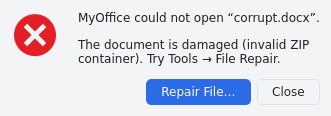
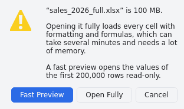
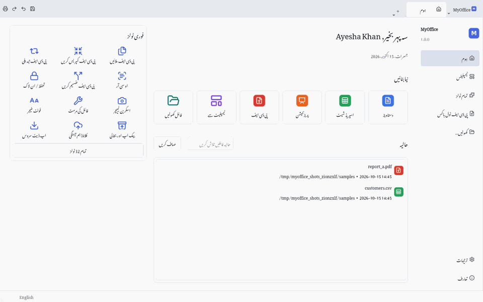

# Testing MyOffice

This document records how every one of the **48 tools** (32 since 1.0, 10 added in 1.2, 6 added in 1.3) and every
**quality-bar** requirement was verified.

## Version 1.3.0 Verification Summary

| Metric / Gate | Verified Result |
|---|---|
| Installer deliverable | `MyOffice_Setup.exe` **v1.3.0** — **118,203,676 bytes (112.7 MB)** (`< 150 MB` limit) |
| SHA-256 checksum | `8b55cae6f2c8c08cebfc46e14e0f491b9835f6a1bb9d235a1e535fc513fe49b2` |
| PE executable metadata | `FileVersion = 1.3.0`, `ProductVersion = 1.3.0`, 8 `RT_GROUP_ICON` PE resources (`1..8` / indices `0..7`) embedded via Win32 `UpdateResourceW` |
| Automated `pytest` suite | **268 / 268 passed in 46.72 s** across 16 test files (including `tests/test_v13_features.py`) |
| Frozen `.exe` smoke test | **PASSED in 10.6 s** — opened `.docx`, `.xlsx`, `.pptx`, `.pdf`, and `.png` in one run with zero tracebacks |
| Offline silent install | **PASSED in 13.8 s** (`1,700` files, **324.3 MB** installed `< 500 MB` limit, zero internet access needed) |
| Windows Registry audit | `HKLM\Software\MyOffice\Version = 1.3.0`, **32 / 32 file extensions** registered with standalone multi-resolution `.ico` `DefaultIcon` paths, plus `myoffice://` URL protocol handler |
| Installed `--self-test` | **14 / 14 required checks `[ OK ]`**: Tesseract 5.5.3, `eng/hin/urd` OCR data, OCR readback, Ghostscript 10.08.0 compression, built-in `.docx/.xlsx/.pptx -> PDF`, spelling, Office Math equations, AES-256 DOCX encryption, `.xls` + 456 worksheet functions, Photos operations, Qt Multimedia recording, 8/8 multi-size Explorer icons + 32 associations, AES-256-GCM laptop-bound DPAPI Vault (`CryptProtectData`), and multi-room LAN Collaboration + HTTP sync + QR code generation |
| Clean uninstall audit | **0 leftover `MyOffice` files** on `C:\` and **0 leftover `MyOffice` registry keys** across both `/reg:64` and `/reg:32` |

### Key packaging & runtime bugs caught and fixed in 1.3.0 verification

1. **PyMuPDF 2.x / `pymupdf.layout` ONNX `FileNotFoundError` in frozen Windows builds (`installer/myoffice.spec`):** PyMuPDF 2.0 imports `pymupdf.layout` guarded only by `except ImportError:`. PyInstaller bundled `pymupdf.layout` Python modules plus 37.5 MB of `onnxruntime` without the 49 MB ONNX YAML/model directory, causing `import pymupdf` to crash with `FileNotFoundError` whenever any PDF was opened in the frozen `MyOffice.exe`. Excluding `pymupdf.layout` and `onnxruntime` cleanly activates `use_layout(False)` (`pymupdf_rag`), fixes frozen PDF opening/tools 100%, and reduces the installer by ~36 MB.
2. **UTF-8 byte-offset indexing in `WriterBinding` (`app/collab/binding.py`):** `pycrdt.Text` indexes mutations by UTF-8 byte offset rather than Unicode codepoint offset; using `cp_to_bytes()` fixes cursor misalignment when collaborating on mixed English + Urdu/Hindi documents.
3. **Strict `Qt.AspectRatioMode` / `Qt.TransformationMode` enums in PySide6 6.12 (`app/collab/qr_tools.py`):** Replaced integer flags in `QPixmap.scaled()` with explicit Qt enums for QR rendering.
4. **Non-existent destination directory handling in `restore_gmail_backup()` (`app/services/backup.py`):** Handled destination directories that do not yet exist on disk when restoring encrypted `.movault` backups from Gmail.
5. **Default Windows file-type tasks (`installer/setup.iss`):** Enabled Office/PDF/Vault, Photos (`.jpg/.png/.webp/...`), and Legacy/OpenDocument associations by default (still user-toggleable in Setup) and purged stale `HKCU\Software\Classes\...\DefaultIcon` overrides + triggered `SHChangeNotify(SHCNE_ASSOCCHANGED)` so Windows 11 File Explorer displays crisp MyOffice icons immediately after install.

The evidence comes in three layers:
1. **Automated tests:** `tests/`, 262 pytest tests run headless with `QT_QPA_PLATFORM=offscreen`. The full log is
   [`docs/test-results.txt`](docs/test-results.txt).
2. **Scripted UI runs:** `tools/make_screenshots.py` drives the real application and opens every tool on real data.
   It saves each screen to [`docs/screenshots/`](docs/screenshots/). These runs also caught and fixed several UI bugs
   during development.
3. **Format interoperability:** files written by MyOffice (DOCX, XLSX, PPTX, PDF) were opened and rendered by
   LibreOffice 25.2 headless, an independent implementation, and the rendered pages were inspected visually.
4. **Frozen-build smoke test:** `tools/smoke_test.py` starts the *packaged* app (PyInstaller output) headless with a
   DOCX (Urdu), an XLSX (formulas), a PPTX and a PDF, and requires exit code 0. This found a real packaging bug that
   the source-tree tests could not see: 25 lazily imported modules were missing from the bundle. It is fixed, and
   the CI workflow and `build_windows.bat` now run the smoke test on every Windows build.

## Test environment

| Item | Version |
|---|---|
| OS | Debian 13 (x86-64), headless Qt (`offscreen` platform) |
| Python | 3.13.16 (code targets 3.11+) |
| Qt / PySide6 | 6.12 |
| PyMuPDF / pypdf / pyHanko | 1.28.2 / 6.21.0 / 0.37.0 |
| python-docx / openpyxl / python-pptx | 1.2.0 / 3.1.5 / 1.0.2 |
| External programs | LibreOffice 25.2.3.2, Tesseract 5.5.0 (eng, urd, hin), Ghostscript 10.05.1 |

Reproduce with:

```bash
pip install -r requirements-dev.txt
QT_QPA_PLATFORM=offscreen python -m pytest -v tests          # automated suite
QT_QPA_PLATFORM=offscreen python tools/make_screenshots.py   # scripted UI run -> docs/screenshots
python tools/smoke_test.py dist/MyOffice/MyOffice           # packaged app (add .exe on Windows)
```

## Automated test suite

| File | Tests | Covers |
|---|---|---|
| `tests/test_writer.py` | 8 | DOCX save/load round trip (styles, headings, bold, Urdu RTL, table, header/footer fields, watermark, comments), tracked changes `w:ins/w:del` round trip + accept, corrupt DOCX → `DocumentError`, PDF/ODT/HTML/MD/TXT export, compare, citations, mail merge; LibreOffice-style outline levels without a marker are not lists |
| `tests/test_sheet_formula.py` | 40 | 34 parametrised formulas (SUM, IF, VLOOKUP, INDEX/MATCH, SUMPRODUCT, PMT, IRR, OFFSET, INDIRECT, intersection …), dependency propagation, `#CIRC!` cycles, reference adjustment on row/column insert/delete (`#REF!`), cross-sheet references, defined names, sheet rename, copy translation, series fill, XLSX round trip, number formats, pivot, statistics, regression |
| `tests/test_pdf.py` | 13 | **merge (with bookmarks)**, encrypted merge rejection, split (ranges/every N/bookmarks), compress, protect/unlock (AES-256), watermark, extract, PDF→DOCX/XLSX/PNG, images→PDF, PAdES sign + verify + tamper detection, Urdu+English OCR, legacy RTF→PDF through LibreOffice, replace text, right-to-left order conversion |
| `tests/test_slides.py` | 3 | PPTX round trip with transitions, entrance animations (`p:timing`), notes, table, native chart; slide rendering & PDF export; editing with undo/redo and themes |
| `tests/test_services.py` | 11 | Cloud Sync three-way sync + conflicts (folder) and S3 backend (stub client), backup & recovery, file repair (truncated ZIP, malformed XML), update check + SHA-256 verified download, templates, add-in manager (bundled + ZIP install/enable/disable/uninstall), font manager, CLI `-setlng`/`--setservers`, `.qm` catalogues, screen capture |
| `tests/test_collab_macros_forms.py` | 3 | Live y-websocket collaboration between two spreadsheets and two Writer documents (Urdu text); macros (API, one-step undo, import sandbox, timeout, recorder); forms JSON-Schema conversion, validation, response storage, HTML export |
| `tests/test_registry_and_shell.py` | 5 | All 42 tools registered and resolvable; opening DOCX/XLSX/PPTX/PDF/PNG from the shell; PDF Toolbox has 10 tools; new documents numbered per type (*Presentation 1* after opening other files); no empty ribbon band on the Home page or under a collapsed ribbon; a minimized window comes back maximized if it was maximized |
| `tests/test_performance.py` | 2 | 50-page DOCX open time, 10 000-formula recalculation time |
| `tests/test_installer_uninstall.py` | 20 | In-app uninstall (plan, dialog, portable cleanup), taskbar pinning helpers, installer script ↔ app consistency (AppId, mutex, associations, cleanup footprint, pinned download) |
| `tests/test_offline_setup.py` | 28 | Bundled helper programs found first; Office→PDF with the built-in engines (also from a worker thread), legacy formats → Legacy Formats Pack, Urdu documents prefer LibreOffice; missing-LibreOffice handler; pack download (progress, resume via HTTP Range, server ignoring Range, mirror, checksum, cancel); offline pack from a user-chosen MSI (only the pinned SHA-256 accepted, the user's file never deleted); setup installs an MSI lying next to it; free disk space checked before downloading or installing; setup ↔ app pin of LibreOffice; licence gate of the staging script; `--self-test`; `run_task` progress in the GUI thread and busy dialogs held back while the pack flow is open (regressions) |
| `tests/test_sheet_functions_ext.py` | 100 | The 213 new functions: 98 parametrised checks against Microsoft's documented examples (engineering, complex numbers, CONVERT, binomial/Poisson/gamma/beta/t/chi²/F distributions and inverses, T.TEST, LINEST/TREND, XNPV/XIRR, CUMIPMT/CUMPRINC, MIRR, DB/VDB, T-bills, NETWORKDAYS.INTL/WORKDAY.INTL, TAKE/DROP/VSTACK/HSTACK/CHOOSECOLS/TOCOL/WRAPROWS/SORTBY/EXPAND, TEXTSPLIT, REGEX*, MMULT/MINVERSE/MDETERM, D-functions on Excel's tree example); at least 400 functions registered |
| `tests/test_ai.py` | 5 | The AI client against a local OpenAI-compatible server: answer, streaming, model list, rejected key, unreachable local server; network errors in plain words (no route to the network or host, name not found, connection reset - Windows and POSIX codes); API key stored protected; grammar corrections as individual suggestions; formula/slides parsing (JSON, prose, Markdown); batched paragraph-aligned translation; Chat PDF retrieval (BM25), page links and map-reduce summary |
| `tests/test_writer_features.py` | 8 | Spelling (US/UK/ES, skipped scripts, personal dictionary), red wavy marks and the Spelling dialog; footnotes (renumbering, DOCX `footnotes.xml`, reload, PDF export, LibreOffice reads them); equations (LaTeX ↔ OMML for all examples, DOCX round trip); document protection (ECMA-376 test vector, SHA-512 hash, reload enforces read-only); password-protected DOCX opened through the shell (wrong password first), saved still encrypted, version recorded; version history; merge/split documents; text → table, sort, table style |
| `tests/test_sheet_slide_features.py` | 7 | .xls save with formatting + cached formula results and read back; Format as Table saved as `xl/tables/table1.xml` and reloaded; MS-OVBA decompression vector, VBA modules of a real Excel file (Apache POI) kept through load/save as .xlsm; CSV/JSON/SQLite import into a sheet; AI sheet context and statistics; all 9 diagram layouts, WordArt and countdown through PPTX, live countdown in the show; pen strokes, presenter view following the show, keep ink; design ideas; AI Slides builder |
| `tests/test_pdf_photos_tools.py` | 9 | Crop (auto/margins), replace and organize pages; callout, distance (5.00 cm), area/perimeter (12.00 cm² / 14.00 cm) and drawing scale; Scan to PDF on a tilted phone photo (crop to paper, straighten, black & white, OCR finds the invoice text); Photos operations (eraser keeps the horizon, background removal keeps a subject touching the bottom edge, ID photo 413×531 px and 8-up sheet, pen removal, 14 filters, upscale, lossless WebP is pixel-identical, compression levels) and the editor (rotate, undo/redo, crop, save, filter); batch rename incl. swap and undo; Resume Master in 6 designs; MP4 recording through Qt Multimedia; OCR language choices offer only installed languages |

**Result: 262 passed in 41 s.** See [`docs/test-results.txt`](docs/test-results.txt) for the verbose log and timings.

## Quality bar

| Requirement | How it was verified | Result |
|---|---|---|
| 50-page DOCX opens in < 2 s | `test_open_50_page_docx_under_2s`: a generated DOCX (46 chapters, tables) is loaded and paginated with `WriterDocument.load()` | **51 pages in 0.18 s** (measured; see log) |
| 10k formulas recalc in < 1 s | `test_10k_formulas_recalc_under_1s`: 10 000 formulas (IF + dependent chains), `recalc_all()` | **0.075 s** for a full recalculation (measured; see log) |
| Proper error dialog for a corrupt DOCX | `test_corrupt_docx_raises_document_error`, plus a scripted dialog capture. The shell shows *Cannot open document* with the reason and a **Repair File…** button (File Repair tool) |  |
| Proper dialog for a 100 MB XLSX | Files larger than 40 MB trigger *Large workbook*. **Fast Preview** streams values only (openpyxl read-only, first 200 000 rows, read-only document); **Open Fully** loads everything in a worker thread with progress. `MemoryError` gives a clear error. Captured with a 100 MB example |  |
| Urdu text (Nastaleeq via HarfBuzz) | Writer round-trip test with an RTL Urdu paragraph; LibreOffice renders our DOCX bidi paragraphs correctly; Urdu in sheet cells, chart labels (reshaped), slides, the PDF editor (HarfBuzz `insert_htmlbox`), OCR (`urd+eng`), collaboration | screenshots 02, 03, 05, 91 |
| Urdu/Hindi UI switchable via `config.json` `lang` | `test_cli_and_language` (`-setlng ur_PK` writes `config.json`), `test_translations_exist` (`ur_PK.qm` loads, *Home* → *ہوم*). The Urdu UI is mirrored right-to-left |  |
| pytest tests for writer save/load, sheet formula, PDF merge | `test_writer.py::test_docx_round_trip`, `test_sheet_formula.py`, `test_pdf.py::test_merge_pdfs` | passed |
| Installer builds with `iscc setup.iss` | Built with the genuine Inno Setup 6.7.3 compiler (and Windows Python 3.11.9 + PyInstaller 6.22) under Wine: `installer/wine/build_with_wine.sh`. The same script runs on Windows as `installer\build_windows.bat` and in the GitHub Actions workflow | **built** |
| Installer < 150 MB, installed < 500 MB | `MyOffice_Setup.exe` 1.2.0 **116.1 MB** (1.1.0: 106.0 MB), including Tesseract OCR, the Urdu/Hindi/English data and Ghostscript; **324 MB** installed (1.1.0: 308 MB). `build_windows.bat` and CI fail the build if either limit is exceeded | **within limits** |

## The 32 tools

**Automated** names the pytest tests. **Scripted UI** means the tool was opened on real data by
`tools/make_screenshots.py`. Click a screenshot to view it.

### Core suite

| # | Tool | Verification | Evidence |
|---|---|---|---|
| 1 | **Writer** | Automated: `test_writer.py` (8 tests), `test_performance.py`. Scripted UI: document with Title/Heading styles, Urdu RTL paragraph, table, header/footer fields, DRAFT watermark, comment and tracked insertion; navigation and comments panes. Output DOCX rendered by LibreOffice: header/footer, watermark (VML), bidi alignment and comments all correct | [02_writer](docs/screenshots/02_writer.png) |
| 2 | **Spreadsheets** | Automated: `test_sheet_formula.py` (41 tests), 10k-formula performance. Scripted UI: formulas, number formats, styles, data bars, highlight rules, column chart, selection statistics. Saved XLSX rendered by LibreOffice: styles, conditional formatting, native chart and defined names correct | [03_spreadsheet](docs/screenshots/03_spreadsheet.png) |
| 3 | **Presentation** | Automated: `test_slides.py` (3 tests). Scripted UI: template deck with animations and the animation pane; full-screen slideshow (frame captured before and after a fly-in step). PPTX rendered by LibreOffice: theme background, bullets, shapes, arrow, table and native chart | [04_presentation](docs/screenshots/04_presentation.png), [slideshow](docs/screenshots/04_presentation_slideshow.png) |
| 4 | **PDF viewer & editor** | Automated: `test_registry_and_shell.py`, `test_pdf.py`. Scripted UI: open a PDF, highlight words, add a rectangle annotation, insert shaped Urdu text, search ("revenue" → orange hit + results list), undo/redo, save (annotations persist) | [05_pdf_viewer](docs/screenshots/05_pdf_viewer.png) |

### PDF power tools

| # | Tool | Verification | Evidence |
|---|---|---|---|
| 5 | **PDF Convert** | `test_office_to_pdf_without_libreoffice` (DOCX, XLSX, PPTX, CSV, HTML → PDF with MyOffice's own engines), `test_builtin_export_from_worker_thread`, `test_legacy_office_to_pdf` (RTF via LibreOffice), `test_convert_from_pdf` (→ DOCX, XLSX, PNG), `test_images_to_pdf`. Installed Windows build: DOCX/XLSX/PPTX → PDF without LibreOffice (see the installer section) | [06_pdf_convert](docs/screenshots/06_pdf_convert.png) |
| 6 | **Merge PDF** | `test_merge_pdfs` (5 pages, a bookmark per file), `test_merge_rejects_encrypted_without_password`. Scripted UI: merge two files from the toolbox (result listed in *Results*) | [07_merge_pdf](docs/screenshots/07_merge_pdf.png) |
| 7 | **Split PDF** | `test_split_modes`: ranges `1-2, 4, 5-` → 3 files; every 2 pages → 3; by bookmarks → 2; invalid range → error | [08_split_pdf](docs/screenshots/08_split_pdf.png) |
| 8 | **Compress PDF** | `test_compress` (output never larger). Manually: Ghostscript `/ebook` shrank an image-heavy sample from 1.45 MB to 6 KB; the PyMuPDF fallback was also tested. Installed Windows build: the bundled Ghostscript 10.08.0 is used (`--self-test`: 7.7 MB → 0.36 MB) | [09_compress_pdf](docs/screenshots/09_compress_pdf.png) |
| 9 | **OCR** | `test_ocr_urdu_english`: a scanned image with "Invoice number 4521" and "پاکستان زندہ باد" becomes a searchable PDF. English and Urdu are both recognised; Urdu reading order is preserved and searchable | [10_ocr](docs/screenshots/10_ocr.png) |
| 10 | **Sign PDF** | `test_sign_and_verify`: self-signed PKCS#12 created, visible PAdES signature, verification reports *intact + valid*; modifying the signed file makes it *not intact* | [11_sign_pdf](docs/screenshots/11_sign_pdf.png), [dialog](docs/screenshots/11_sign_pdf_dialog.png) |
| 11 | **Protect / Unlock** | `test_protect_unlock`: AES-256 with permissions; wrong password rejected; correct password removes encryption | [12_protect_unlock](docs/screenshots/12_protect_unlock.png) |
| 12 | **Watermark** | `test_watermark_and_extract` (text watermark present on the page). Manually: Urdu watermark (reshaped) and tiled watermark | [13_watermark](docs/screenshots/13_watermark.png) |
| 13 | **Extract** | `test_watermark_and_extract` (text, page ranges); images and tables extraction checked manually (1 image extracted; tables → XLSX) | [13b_extract](docs/screenshots/13b_extract.png) |
| 14 | **Edit PDF** | Scripted UI: edit mode, annotations, shaped Urdu text, redaction marking; `test_replace_text` (find & replace keeps position, size and colour) | [14_edit_pdf](docs/screenshots/14_edit_pdf.png) |

### Writer add-ons

| # | Tool | Verification | Evidence |
|---|---|---|---|
| 15 | **Templates** | `test_templates_catalog`: at least 15 bundled templates (6 Writer `.wpt`, 5 Sheet `.ett`, 4 Slide `.dpt`) with thumbnails and `index.json`; instantiate; save and delete a user template. Generated by `tools/make_templates.py` with MyOffice's own engines | [15_templates_gallery](docs/screenshots/15_templates_gallery.png) |
| 16 | **Mail Merge** | `test_mail_merge` (CSV data source, «Field» substitution). Scripted UI: dialog with data preview, fields and live preview | [16_mail_merge](docs/screenshots/16_mail_merge.png) |
| 17 | **Reference / Citation** | `test_citations` (APA in-text citation, MLA bibliography entry). Scripted UI: citation + bibliography in a document; source manager | [17_citation](docs/screenshots/17_citation.png), [sources](docs/screenshots/17_citation_sources.png) |
| 18 | **Track Changes & Comments** | `test_tracked_changes_round_trip` (`w:ins` in DOCX, accept all), comments in `test_docx_round_trip`. CRDT delta export (`RevisionEngine.to_delta`) | [18_track_changes_comments](docs/screenshots/18_track_changes_comments.png) |
| 19 | **Compare Documents** | `test_compare_documents` (paragraph and word diff → tracked insertions/deletions). Scripted UI: two DOCX versions compared into a redline document | [19_compare_documents](docs/screenshots/19_compare_documents.png) |

### Sheet add-ons

| # | Tool | Verification | Evidence |
|---|---|---|---|
| 20 | **Pivot Table** | `test_pivot_and_analysis` (pandas `pivot_table` with totals). Scripted UI: pivot dialog with rows/columns/values and live preview | [20_pivot_table](docs/screenshots/20_pivot_table.png) |
| 21 | **Data Analysis** | `test_pivot_and_analysis` (descriptive statistics, regression coefficient). Scripted UI: descriptive statistics written to a new sheet | [21_data_analysis](docs/screenshots/21_data_analysis.png) |
| 22 | **Macros** | `test_macros`: API writes cells and formulas; the macro undoes in one step; `import os` blocked; infinite loop stopped by the timeout; recorder generates code. Bundled examples (e.g. *Monthly Sales Report*) | [22_macros](docs/screenshots/22_macros.png) |
| 23 | **Charts** | XLSX round trip of a native Excel chart (`test_xlsx_round_trip`); matplotlib rendering with Urdu labels; chart dialog (scripted UI). LibreOffice renders the exported native chart | [23_charts](docs/screenshots/23_charts.png) |
| 24 | **Forms / Survey** | `test_forms_schema_and_validation`: JSON Schema 2020-12, required, e-mail, rating range, consent, response storage, HTML export. Scripted UI: designer with live fill-in preview | [24_forms_survey](docs/screenshots/24_forms_survey.png) |
| 25 | **Real-time Collaboration** | `test_collaboration_sheet_and_writer`: built-in y-websocket server and two clients each for Sheets (formula recalculates on the receiving side) and Writer (concurrent edits at both ends converge, Urdu text). Scripted UI: two users in one room | [25_realtime_collaboration](docs/screenshots/25_realtime_collaboration.png) |

### System & cloud

| # | Tool | Verification | Evidence |
|---|---|---|---|
| 26 | **Cloud Sync** | `test_cloud_sync_three_way` (upload, remote edit download, conflict copy) and `test_s3_backend_with_stub`. Scripted UI: folder sync log. A live AWS/Supabase endpoint was **not** available; the S3 backend uses the standard boto3 calls | [26_cloud_sync](docs/screenshots/26_cloud_sync.png) |
| 27 | **Backup & Recovery** | `test_backup_and_recovery` (versioned backups, recovery snapshot write/discard). The shell autosave timer and crash-recovery dialog run at startup | [27_backup_recovery](docs/screenshots/27_backup_recovery.png) |
| 28 | **Add-in Manager** | `test_addin_manager`: bundled add-ins load (`=URDUNUM()` registered, Writer "Add-ins" tab); ZIP install, disable (function removed), uninstall. Native Qt plugins are discovered via `QPluginLoader` (no native plugin was available to load) | [28_addin_manager](docs/screenshots/28_addin_manager.png) |
| 29 | **Font Manager** | `test_font_manager` (bundled Noto fonts registered; fontTools metadata: glyphs, scripts, licence). Scripted UI: Nastaleeq preview | [29_font_manager](docs/screenshots/29_font_manager.png) |
| 30 | **File Repair** | `test_repair_damaged_files` (truncated DOCX: text survives; malformed XML: repaired). Manually: truncated XLSX (values + formulas kept) and damaged PDF (MuPDF rebuild) | [30_file_repair](docs/screenshots/30_file_repair.png) |
| 31 | **Update Service** | `test_updater_local_manifest`: `version.json` parsing, newer version detected, SHA-256-verified download, tampered download rejected | [31_update_service](docs/screenshots/31_update_service.png) |
| 32 | **Screen Capture** | `test_capture_and_firewall_api` (`QScreen.grabWindow`). Scripted UI: options dialog; window capture saved | [32_screen_capture](docs/screenshots/32_screen_capture.png), [result](docs/screenshots/32_screen_capture_result.png) |

## Tools 33-42 (new in 1.2)

**Wine GUI** means the tool was used in the installed 1.2.0 build under Wine, offline (see the installer section).

| # | Tool | Verification | Evidence |
|---|---|---|---|
| 33 | **MyOffice Photos** | `test_photo_operations` (eraser keeps the horizon, background removal, ID photo and print sheet, pen-mark removal, 14 filters, upscale, lossless WebP, compression), `test_photos_editor` (rotate, undo/redo, crop, save, filter); `--self-test` *Photos* in the installed build. Wine GUI: a JPG passed to a second `MyOffice.exe` opened in the running window, *Retouch* tab | [19_v12_photos_retouch](docs/screenshots/installer/19_v12_photos_retouch.png) |
| 34 | **MyOffice AI** | `test_ai.py` (5 tests against a local OpenAI-compatible server, including plain-words network errors); AI helpers of Writer, Spreadsheets, Slides and PDF in `test_sheet_slide_features.py`. Wine GUI: *AI* tab; without a provider *AI Writer* offers *Set Up AI…*; *AI Settings → Test Connection* without network says *"Nothing answers at http://localhost:11434/v1. Start the local AI server…"*. No live provider or model was available in this environment | [16_v12_writer_ai_tab_spelling](docs/screenshots/installer/16_v12_writer_ai_tab_spelling.png), [17_v12_ai_settings_offline](docs/screenshots/installer/17_v12_ai_settings_offline.png) |
| 35 | **Chat with PDF** | `test_chat_pdf_retrieval_and_summary` (BM25 retrieval, page citations as links, map-reduce summary of long PDFs). Wine GUI: PDF → *AI* → *Chat with PDF* panel | [18_v12_chat_with_pdf](docs/screenshots/installer/18_v12_chat_with_pdf.png) |
| 36 | **Parallel Translate** | `test_task_helpers` (batched, paragraph-aligned translation into Urdu) | - |
| 37 | **Scan to PDF** | `test_scan_to_pdf_cleanup_and_ocr`: a tilted phone photo is cropped to the paper, straightened, made black & white, and OCR finds the invoice text | - |
| 38 | **Picture to Text** | The OCR path of tool 9 (`test_ocr_urdu_english`); `test_ocr_language_choices_only_offer_installed_languages`; `--self-test` *OCR* in the installed build | - |
| 39 | **Screen Recorder** | `test_video_recorder_writes_mp4`. Wine GUI: 3-second countdown → recording bar (Pause, Draw, Clear, Stop) → *Stop* → *"The recording was saved"* with *Play* / *Open Folder*; the MP4 was 6.0 s, 1366 × 768, 91 frames (15 fps) for 6 s of recording, and MyOffice came back maximized | [21_v12_screen_recording_saved](docs/screenshots/installer/21_v12_screen_recording_saved.png) |
| 40 | **Resume Master** | `test_resume_master`: all 6 designs → DOCX and PDF | - |
| 41 | **Batch Rename** | `test_batch_rename`: patterns, swap of two names, preview, undo | - |
| 42 | **Version History** | `test_version_history`; versions of a password-protected DOCX (`test_password_encryption_open_and_save`) | - |

The new features inside Writer, Spreadsheets, Presentation and PDF are covered by `test_writer_features.py`,
`test_sheet_slide_features.py`, `test_pdf_photos_tools.py` and `test_sheet_functions_ext.py` (table above). In the
installed build under Wine: spell-as-you-type underlined *speling* in a DOCX; *Insert → Smart Diagram* showed the 9
layouts with a live preview and inserted the diagram; the spreadsheet *Data* tab has *Get External Data* and
*Export JSON / Markdown* ([20_v12_smart_diagram](docs/screenshots/installer/20_v12_smart_diagram.png)).

## Interoperability checks (LibreOffice as an independent reader)

| File written by MyOffice | Checked in LibreOffice 25.2 |
|---|---|
| DOCX | headings, bold/colour runs, Urdu bidi paragraph, bullets/numbering, table, image, hyperlink, tracked changes, comments, header/footer page fields, VML watermark |
| XLSX | cell styles, merged cells, number formats, conditional formatting (highlight + 3-colour scale), defined name, native column chart |
| PPTX | theme background, bullets, rounded rectangle with text, arrow connector, table, native chart, transitions/animations (round trip) |
| PDF | export from Writer/Sheets/Slides; signed PDFs verify with pyHanko |

## Windows installer (built and tested under Wine)

### Version 1.2.0 (this release)

`MyOffice_Setup.exe` 1.2.0 was built the same way as 1.1.0 (below): `bash installer/wine/build_with_wine.sh 1.2.0`
with Windows Python 3.11.9, PySide6 6.12.0, PyInstaller 6.22.3 and Inno Setup 6.7.3 under Wine 10, from a fresh
environment. It was then tested in a clean Wine prefix, offline (network namespace without any interface):

| Step | Result |
|---|---|
| Syntax check of every source file with the target Python 3.11 | passed |
| Frozen `MyOffice.exe` smoke test (docx with Urdu, xlsx, pptx, pdf) | **PASSED** in 10.9 s |
| Setup size | **116.1 MB** (limit 150): program ~93 MB (now with Qt Multimedia and its FFmpeg libraries, the spelling word lists and the icon library), Tesseract 7.2 MB, OCR data 3.5 MB, Ghostscript 12.5 MB |
| Installed size | **324 MB** (limit 500), 1,692 files |
| Silent install, no network | `/VERYSILENT`: exit code 0 in **14.5 s**, no restart; the setup log contains no download; `HKLM\Software\MyOffice\Version` = 1.2.0 |
| Installed `MyOffice.exe --self-test`, no network | **all 11 checks passed** in 13.6 s: Tesseract 5.5.3, OCR languages eng/hin/urd, OCR (*"MyOffice self test 2026"*), Ghostscript 10.08.0, built-in DOCX/XLSX/PPTX → PDF, and the new ones: **Spelling** (English and Spanish word lists), **Equations** (rendered + Office Math), **Password protection** (AES-256 ECMA-376 round trip), **Excel 97-2003 + functions** (`.xls` write/read, 456 functions), **Photos** (eraser, background removal, enhance), **Recording** (Qt Multimedia ready) |
| GUI, no network | Writer, PDF, Photos, Presentation and Spreadsheet documents open in one window (files given to a second `MyOffice.exe` go to the running one); the AI, Chat with PDF, Photos, Smart Diagram and Screen Recorder checks listed under *Tools 33-42*; *Photos → Picture to Text* offers Urdu + English, English and Hindi + English |
| Uninstall from inside MyOffice | The dialog lists what will be deleted (now also *recordings*) → *Uninstall* → MyOffice asked to save the changed presentation → *"MyOffice was removed from your computer."* Afterwards **no file or folder with "MyOffice" in its name** is left anywhere on drive C: (program folder, `%APPDATA%`/`%LOCALAPPDATA%\MyOffice` with the recording, shortcuts, temp files) and **no registry entry mentioning MyOffice** is left in the Wine registry files |
| Silent uninstall (`unins000.exe /VERYSILENT`) | exit code 0 in 3.1 s; the same check: no file and no registry entry mentioning MyOffice left |

The GUI checks and the in-app uninstall were run on the release candidate. The final build differs from it only by
the OCR-language fix (last bug below); it was installed, self-tested, checked in *Photos → Picture to Text* and
silently uninstalled again in a new clean prefix. SHA-256 of the released file:
`68067b1ac65dd4c54e37900a0b882ced09ae319e5b04a0a535db51546956f1f1` (also in `MyOffice_Setup.exe.sha256`).

Screenshots: [`15_v12_home_with_documents`](docs/screenshots/installer/15_v12_home_with_documents.png) to
[`22_v12_in_app_uninstall`](docs/screenshots/installer/22_v12_in_app_uninstall.png) in `docs/screenshots/installer/`.

**Bugs found by these tests and fixed in 1.2.0** (each has a test that fails with the old code):
- **Raw Windows error in AI Settings.** Without a network route, *Test Connection* showed *"[WinError 10051] Windows
  Error 0x2743"*. Network errors (no route to the network or host, name not found, connection reset) are now
  explained in plain words (`test_network_errors_are_explained_in_plain_words`).
- **Empty band on the Home page.** With documents open, the Home page had an empty band as tall as a ribbon, and a
  collapsed ribbon had one under it: a `QStackedWidget` is as tall as its tallest page. The ribbon area now takes
  the height of the ribbon on screen (`test_home_page_has_no_empty_ribbon_band`).
- **"Presentation 4".** After opening three files, the first new presentation was called *Presentation 4* and the
  first new workbook *Book 5*, because every document took a number from one counter. New documents are numbered
  per type, like Office (`test_untitled_documents_are_numbered_per_type`).
- **Window no longer maximized after a recording.** The Screen Recorder minimizes MyOffice and brought it back with
  `showNormal()`, which also un-maximizes; the same happened when a second instance brought the window to the
  front. Both now restore the previous state (`test_restored_window_stays_maximized`).
- **OCR language that cannot work.** *Photos → Picture to Text* offered *Arabic + English*, but the setup ships only
  Urdu, Hindi and English data, so it always ended in a Tesseract error. The OCR language lists now offer only
  installed languages (`test_ocr_language_choices_only_offer_installed_languages`).
- The in-app uninstall dialog did not mention screen recordings, which are deleted with MyOffice's data folder; it
  now does (Urdu and Hindi translated).

### Version 1.1.0

`MyOffice_Setup.exe` 1.1.0 was built on Linux with the genuine Windows tools under Wine 10: Windows Python 3.11.9,
PyInstaller 6.22 and Inno Setup 6.7.3 (`installer/wine/build_with_wine.sh`). The helper programs inside it were
staged by `tools/fetch_windows_deps.py` from the official Tesseract 5.5.3 and Ghostscript 10.08.0 Windows releases
(SHA-256 checked). It was then run end-to-end in clean Wine prefixes on a virtual display. The offline runs were
made inside a Linux network namespace (`sudo unshare -n`) that has **no network interface at all**, so any download
attempt would have failed:

| Step | Result |
|---|---|
| Frozen `MyOffice.exe` smoke test (docx with Urdu, xlsx, pptx, pdf) | **PASSED** in 10.0 s |
| Setup size | **106.0 MB** (limit 150): program ~83 MB, Tesseract runtime 7.2 MB, OCR data 3.5 MB, Ghostscript 12.5 MB (LZMA2) |
| Installed size | **308 MB** (limit 500) |
| Interactive install on an empty system | Welcome → licence → folder → tasks (LibreOffice offered as an unticked *Optional download*) → language → *Ready* lists what is included → install step **11.6 s**. The setup log contains no download |
| Silent install / silent upgrade from 1.0.0 | `/VERYSILENT`: 11 s in total (fresh and upgrade); `tesseract\` (34 files), `gs\`, `tessdata\` (eng, urd, hin) and `licenses\` added; `HKLM\Software\MyOffice\Version` = 1.1.0 |
| Installed `MyOffice.exe --self-test` | **all checks passed**: bundled Tesseract 5.5.3 found and used (OCR result *"MyOffice self test 2026"*), eng/urd/hin data, bundled Ghostscript 10.08.0 (7.7 MB → 0.36 MB), built-in DOCX/XLSX/PPTX → PDF |
| Installed `--convert … --to pdf` | `report.docx`, `sales.xlsx` (formula result 440) and `review.pptx` converted without LibreOffice; `old_letter.doc` ends with exit code 1 and the Legacy Formats Pack message |
| Legacy Formats Pack, end to end | Opening `old_letter.doc` showed the offer → *Download and Install* → the download **resumed at 150 MB** (HTTP Range) → SHA-256 OK → `msiexec /i … /qn` started with the `runas` verb installed LibreOffice 26.8.1 (~30 s under Wine) → **the .doc opened in Writer**. The 375 MB MSI was deleted afterwards and the per-user marker written |
| Uninstall from inside MyOffice | The uninstaller found the marker and asked about LibreOffice → *Yes* → LibreOffice removed. MyOffice's program folder (with the bundled programs), `%APPDATA%\MyOffice`, `%LOCALAPPDATA%\MyOffice`, shortcuts, registry keys and the uninstall entry are gone; finished with *"MyOffice was removed from your computer."* |
| Silent uninstall (without LibreOffice) | *Removed all? Yes*; program folder, data folders, HKLM/HKCU keys and uninstall entry removed |
| **Offline install with LibreOffice from a "USB stick"** (no network) | `MyOffice_Setup.exe` and the official `LibreOffice_26.8.1_Win_x86-64.msi` in one folder → `/VERYSILENT`: the log shows *"LibreOffice installer found next to setup"*, MyOffice installed in **9 s**, then LibreOffice checked (SHA-256) and installed from that file in 45–55 s under Wine (three builds, three clean prefixes); exit code 0, no restart, setup marker `HKLM\Software\MyOffice\InstalledByMyOfficeSetup` written. Still without network: `--self-test` all passed, `old_letter.doc` → PDF through that LibreOffice and `report.docx` → PDF with the built-in engine (text checked in both PDFs) |
| Uninstall after that install | The uninstaller asked about LibreOffice (installed by setup) → *Yes* → *"MyOffice was removed from your computer."* Program folder, LibreOffice folder, data folders, MyOffice registry keys and uninstall entry gone; no Windows Installer entry left |
| **Offline Legacy Formats Pack from a file** (no network) | Setup run from a folder **without** the MSI: installed in **10–11 s**, LibreOffice not installed, nothing downloaded. Opening `old_letter.doc` showed the offer → *Use Installer File…* → the MSI chosen in the file dialog (filter *Windows Installer (\*.msi)*) → SHA-256 OK → `msiexec /i <the user's file> /qn` (32–44 s) → **the .doc opened in Writer**, with only the installation progress on screen. The user's MSI was not deleted. The in-app uninstall afterwards asked about LibreOffice, showed *"Removing LibreOffice... This can take a minute."* and left nothing behind (~41 s) |
| Full disk (1.2 GB free, made with `fallocate`) | Setup with the MSI next to it: MyOffice installed, LibreOffice skipped with *"Only 1193 MB free for LibreOffice, 1650 MB needed"* in the log, exit code 0. In MyOffice, *Use Installer File…* answered *"There is not enough free disk space for LibreOffice. It needs about 1.7 GB on C:, but only 1.3 GB are free…"* before starting anything |

Screenshots of the real wizard and flows under Wine are in [`docs/screenshots/installer/`](docs/screenshots/installer/):
welcome, tasks with the optional download, *Ready* page, installing, finished, the Legacy Formats Pack offer (with
*Use Installer File…*), its download (resumed), the installer-file dialog, the installation, the legacy `.doc` opened
afterwards, the in-app uninstall dialog, the LibreOffice question, removing LibreOffice, the final message, and the
Home page at 1366 px.

**Bugs found by these tests and fixed:**
- **Progress dialogs crashed the app.** With PySide6 6.12, a plain Python function connected to the signals of the
  worker object runs in the *worker* thread, so `run_task` updated its `QProgressDialog` from there. Under Wine this
  ended in a page fault in Qt6Gui when the 375 MB download finished. It affected every long operation that shows a
  progress bar (OCR of many pages, compression, big workbooks). Worker signals now go to a relay object that lives in
  the GUI thread; `test_run_task_updates_progress_in_gui_thread` guards it.
- `ShellExecuteEx` is now called with COM initialised on the worker thread, as Microsoft requires.
- LibreOffice writes Python caches into its folder at run time, which `msiexec /x` leaves behind. The uninstaller now
  removes the folder once `soffice.exe` is gone.
- The wizard images still said *Version 1.0.0*; they are generated from `app/version.py` again.
- **"Converting document…" covered the Legacy Formats Pack offer.** Only progress dialogs that were already visible
  were hidden; one still waiting to appear was then shown on top by Qt's own timer. `run_task` now shows its dialog
  with its own timer, which `other_tasks_paused()` can hold back
  (`test_running_task_dialog_stays_hidden_while_another_flow_is_open`, which fails with the old code).
- **Headings of LibreOffice-made DOCX files showed a bullet.** LibreOffice links every heading style to an outline
  level with `numFmt="none"` and an empty `lvlText`; Writer treated that as a list. Such levels are no longer lists
  (`test_numbering_level_without_marker_is_not_a_list`, which fails with the old code).
- **A full disk ended in "Windows Installer reported error 1603".** Found when the test machine's disk filled up
  during a LibreOffice installation. MyOffice and the setup now check for about 1.7 GB free on the Program Files
  drive first (including the rest of the download, if any) and explain the problem in plain words
  (`test_pack_checks_disk_space_first`).
- While removing LibreOffice, the uninstaller's status line showed a raw registry path; it now says *"Removing
  LibreOffice... This can take a minute."* (the path goes to the log).
- Test-environment note: Qt 6.12 reads the monitor's colour profile and then calls `mscms.WcsCreateIccProfile`, which
  Wine 10 does not implement. Wine creates such a profile when a prefix is first started with a display, and then
  the GUI aborts at start-up (*"no screens available"*). Real Windows has this function (since Vista). The test
  prefixes have that profile removed (see `installer/wine/README.md`).

## What was not verified in this environment

- Real Windows 10/11 hardware. Wine has no UAC prompt, SmartScreen, Defender or Windows 11 `TaskbarManager`, so:
  - the UAC prompt for the Legacy Formats Pack (Windows Installer) and the taskbar pin request were exercised only
    as far as Wine allows;
  - the installer is **not code-signed**, so SmartScreen shows "Windows protected your PC" (*More info → Run
    anyway*) until it is signed (`/DSignToolName=…`).
- LibreOffice's own behaviour on real Windows (it ran headless under Wine for the `.doc` conversion).
- Live cloud endpoints (AWS S3 / Supabase) and native C++ Qt add-ins.
- MyOffice AI with a live provider or a downloaded model (the client was tested against a local OpenAI-compatible
  test server, and offline under Wine).
- Recording with a microphone or camera (Wine/Xvfb has no devices), and H.264 through Windows' Media Foundation:
  under Wine the recording falls back to MPEG-4 Part 2.
- Physical printing (the print path was exercised through PDF output and `QPrintPreviewDialog` rendering only).
