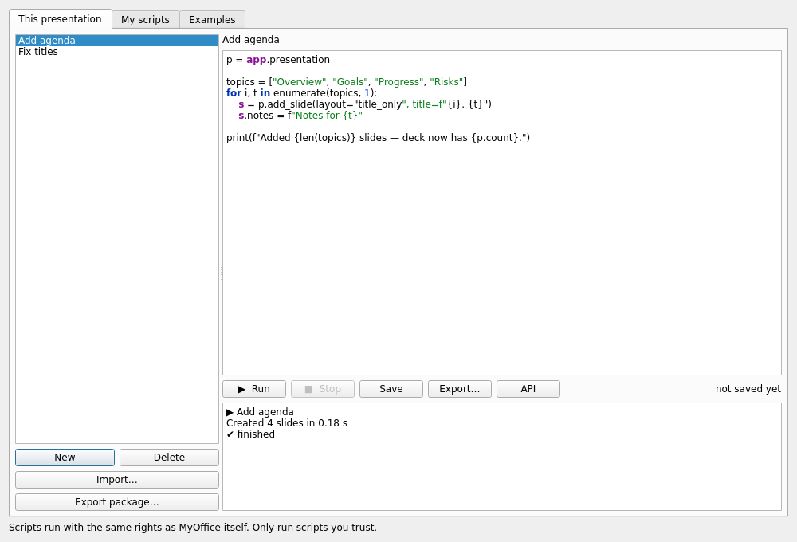

# MyOffice Presentation Scripts — User Guide

*Automate presentations with short Python scripts — the same idea as VBA macros in PowerPoint, built for MyOffice.*

Version 1 (Phase 5 deliverable) · applies to MyOffice 1.6.5+

---

## 1. What it is

A **script** is a small Python program that edits the presentation you have open: add slides, change text,
insert shapes and pictures, build tables and charts, set transitions and animations. You write it in MyOffice,
press **Run**, and see the result — and if anything goes wrong the presentation is left exactly as it was.

Scripts are **not** VBA. There is no `.pptm` magic, nothing hidden inside your `.pptx`, and a script only does
what you can see it doing. (See §5 for the honest security picture.)

---

## 2. Opening the script editor

Any of these:

| Where | Action |
| :-- | :-- |
| Ribbon → **Tools** → group **Automation** | **Scripts** |
| Presentation thumbnails → right-click | **Scripts for this presentation…** |
| Keyboard | **Alt+F8** (same shortcut as spreadsheet macros) |



The window has three tabs:

* **This presentation** — the scripts that travel with this deck.
* **My scripts** — your personal library, available from every deck.
* **Examples** — five working scripts you can copy and adapt.

Buttons: **▶ Run**, **■ Stop**, **Save**, **New**, **Delete**, **Import…**, **Export…**, **Export package…**,
**API** (a reference generated from the code itself).

---

## 3. Your first script, step by step

1. Open or create a presentation, press **Alt+F8**.
2. Tab **Examples** → choose **Add Slides** → **Copy into this presentation**.
3. Switch to **This presentation**, press **▶ Run**.
4. Six slides appear. Press **Ctrl+Z** once — all six disappear, because one run is one undo step.

Now write your own. **New** → name it → type:

```python
p = app.presentation

s = p.add_slide(layout="title_content", title="Hello", body="Made by a script")
s.notes = "Speaker notes can be set too."
s.transition = "fade"

print("Slides:", p.count)
```

Notes on what you just wrote:

* `app` is the entry point. `app.presentation` is your deck (also available as `app.slide`).
* `add_slide()` **appends** to the end and returns the new slide.
* Printing writes to the output pane at the bottom of the dialog. That is your debugger.
* Nothing is saved until you save the presentation.

---

## 4. Where scripts live

| What | Where | Notes |
| :-- | :-- | :-- |
| Scripts of a deck | `Report.pptx.moscript` **next to the deck** | Plain UTF-8 JSON. Written when you save the deck; deleted automatically when the last script is removed. |
| Your library | `slide_scripts` folder in the MyOffice user folder | One `.py` file per script. Always trusted. |
| Examples | Shipped with MyOffice | Read-only; "Copy into this presentation" makes an editable copy. |
| Untitled deck | In memory only | Closing it asks to save the presentation first. |

Nothing is ever written inside the `.pptx`. That keeps the deck portable and safe for other programs.

**Sending a deck *with* its scripts:** **Export package…** writes one `.mopkg` file containing the deck plus its
scripts. The `.pptx` inside is byte-for-byte the original.

---

## 5. Trust and safety — read this once

> **Scripts run with the same rights as MyOffice itself.** They are not sandboxed. Only run scripts you trust,
> exactly as you would only open documents you trust.

The rules MyOffice applies:

| Situation | What happens |
| :-- | :-- |
| You just wrote the script | Runs immediately. |
| Script inside a trusted folder, your own library, or a shipped example | Runs immediately. |
| Script file that arrived from elsewhere (download, email, USB, sync) | **A one-time prompt** names the file and its scripts. Running needs your explicit confirmation. Approving remembers that exact file content — edit the file and you are asked again. |
| Scripts turned off in Settings | Nothing runs. |

What a script **cannot** do:

* `import` anything outside a fixed, safe list (`math`, `re`, `json`, `datetime`, `random`, `statistics`,
  `itertools`, `collections`, `decimal`, `fractions`, `calendar`, `textwrap`, `functools`, `operator`, `string`).
  `import os`, `sys` or `subprocess` raises a clear error.
* Call `open()`, `exec()` or `eval()` — they are not available.
* Reach the network — there is no network API.
* Read a file outside the presentation's folder without asking you first (that is how `add_picture` works).
* Run automatically when a deck opens. There are no "open" events in version 1.

**Honest limitation:** a deliberately hostile script *can* get around Python's builtins list — reduced-builtins
`exec` has never been a security boundary in any product that tried it. Everything above is a guardrail against
accidents, and the trust prompt is your real protection. A genuinely isolated runner (separate process) is
designed for and planned; until it ships, treat a script like a program someone asked you to run.

---

## 6. Settings

`config.json` → `"scripts"`:

```json
{"enabled": true, "timeout": 30, "trusted_dirs": [], "approved": [], "autosave_with_document": true}
```

| Key | Meaning |
| :-- | :-- |
| `enabled` | Global on/off switch for running scripts. |
| `timeout` | Seconds a script may run before it is stopped (default 30). |
| `trusted_dirs` | Folders whose script files run without the trust prompt. Your library folder is always trusted. |
| `approved` | SHA-256 of script files you approved (maintained by MyOffice; bounded to the last 200). |

---

## 7. Recipes

### 7.1 Create N slides from a list

```python
topics = ["Overview", "Goals", "Progress", "Risks", "Next steps"]
for i, t in enumerate(topics, 1):
    app.presentation.add_slide(layout="title_only", title=f"{i}. {t}")
```

### 7.2 Change text on every slide

```python
for slide in app.presentation.slides:
    for shape in slide.shapes:
        if shape.placeholder == "title":
            shape.text = shape.text.upper()      # size, colour and font are kept
```

### 7.3 Add shapes

```python
s = app.presentation.slides[0]
badge = s.shapes.add_shape("round_rect", 60, 60, 320, 90, text="NEW", fill="#1F3864")
badge.align = "center"
badge.rotation = 5
```

Kinds: `text`, `rect`, `roundrect`, `ellipse`, `triangle`, `diamond`, `pentagon`, `hexagon`, `arrow_right`,
`arrow_left`, `star5`, `line`, `arrow_line`, `image`, `table`, `chart`. Friendly aliases work too
(`round_rect`, `circle`, `star`, `arrow`).

### 7.4 Add a picture

```python
s.shapes.add_picture("logo.png", app.emu(40), app.emu(400), w=app.emu(160))
```

Omit `h` and the aspect ratio is kept. The first read of a file outside the deck's folder asks permission.

### 7.5 Table and chart

```python
s.shapes.add_table([["Quarter", "Sales"], ["Q1", "120"], ["Q2", "150"]],
                   x=app.emu(60), y=app.emu(150), w=app.emu(420), h=app.emu(180))

s.shapes.add_chart("column", ["Q1", "Q2"], [["Sales", [120, 150]]],
                   title="Sales", x=app.emu(520), y=app.emu(150), w=app.emu(380), h=app.emu(300))
```

Chart kinds: `column`, `bar`, `line`, `pie`, `area`, `doughnut`, `scatter`.

### 7.6 Animate shapes in order

```python
for i, shape in enumerate(app.presentation.slides[0].shapes):
    shape.animate("fade", trigger="click", duration=0.4, delay=0.1 * i)
```

Effects: `appear`, `fade`, `fly_in`, `zoom`, `wipe`, `float_in`; triggers `click`, `with`, `after`.

### 7.7 Notes and transitions everywhere

```python
for i, slide in enumerate(app.presentation.slides, 1):
    slide.notes = f"Slide {i}"
    slide.set_transition("push", duration=0.8, all_slides=True)
```

### 7.8 Find something

```python
for shape in app.presentation.find("TODO"):
    shape.text = shape.text.replace("TODO", "DONE")
```

### 7.9 Restyle the deck

```python
app.presentation.apply_theme("Midnight")
app.presentation.set_size("4:3")
```

Themes: `Office`, `Ocean`, `Midnight`, `Sunrise`, `Forest`, `Royal`.

### 7.10 Delete and reorder

```python
p = app.presentation
p.move(3, 1)              # move slide 3 (0-based) to position 1
for s in list(p.slides):
    if not s.title.strip():
        s.delete()        # never deletes the last remaining slide
```

---

## 8. API reference

Generated from the source at runtime (**API** button) — this is the same list. Coordinates are **EMU**:
`app.emu(pixels)` converts; any value below 1000 is treated as pixels and converted for you (a note is printed).

### App helpers

| Helper | Meaning |
| :-- | :-- |
| `app.presentation`, `app.slide` | The deck this script belongs to |
| `app.emu(px)`, `app.px(emu)` | Unit conversion |
| `app.log(text)` / `print(text)` | Write to the output pane |
| `app.message(text)` | Information dialog |
| `app.confirm(text)` | Yes/No dialog → `bool` |
| `app.input(prompt, default="")` | Text input → `str` |
| `app.status(text)` | Message in the status bar |
| `app.sleep(ms)` | Pause (max 5000 ms), UI stays responsive |
| `app.new_presentation()` | Create a new deck and return its API |
| `app.open(path)` | Open a file in MyOffice (permission-gated) |

### `PresentationAPI` — `app.presentation`

| Member | Meaning |
| :-- | :-- |
| `name`, `path`, `title` | File name, full path, deck title (title is writable) |
| `width`, `height`, `size_px` | Slide size (EMU, and pixels as a tuple) |
| `count`, `len(p)` | Number of slides |
| `slides` → `SlideListAPI` | The slide list |
| `theme` → `ThemeAPI` | Heading/body font, accent, title/text colour |
| `current` | Slide index shown in the editor (writable) |
| `add_slide(layout, title, body, index=None)` | Append (or insert) → `SlideAPI` |
| `duplicate(index)`, `delete(i)`, `move(from_i, to_i)` | Slide management |
| `apply_theme(name)`, `set_size("16:9" \| "4:3" \| (w, h))` | Design |
| `find(needle)` | `[ShapeAPI]` whose text contains `needle` |
| `save()`, `save_as()`, `export_pdf(path)`, `refresh()` | File operations |

### `SlideListAPI` — `p.slides`

`len()`, iteration, `slides[0]`, `slides[-1]`, `slides[1:3]`, `slides.add(...)`, `slides.remove(s)`,
`slides.index_of(s)`, `slides.current`.

### `SlideAPI`

| Member | Meaning |
| :-- | :-- |
| `index`, `id`, `is_current`, `presentation` | Identity |
| `layout` | `title`, `title_content`, `section`, `two_content`, `title_only`, `blank`, `comparison` (writable; adds missing placeholders) |
| `title`, `notes`, `hidden`, `background` | Content (all writable) |
| `transition`, `set_transition(kind, duration, direction, all_slides)` | `none`, `fade`, `push`, `wipe`, `cover`, `zoom`, `split` |
| `shapes` → `ShapeListAPI`, `texts()`, `clear()` | Shapes |
| `duplicate()`, `delete()`, `move(delta)`, `select()` | Lifecycle |
| `set_background(color, image, all_slides)` | Solid colour and/or picture |

### `ShapeListAPI` — `slide.shapes`

`len()`, iteration, `shapes[0]`, `shapes["Name"]`, `shapes.find(name)`, `shapes.names()`,
`shapes.add_textbox(x, y, w, h, text, size, bold, color, align, font, fill, line, name)`,
`shapes.add_shape(kind, x, y, w, h, text, fill, line, size, color, align, name)`,
`shapes.add_picture(source, x, y, w, h, name)`,
`shapes.add_table(rows, x, y, w, h, header, color, name)`,
`shapes.add_chart(kind, categories, series, title, x, y, w, h, legend, name)`,
`shapes.remove(s)`, `shapes.clear()`, `shapes.top()`, `shapes.bottom()`.

### `ShapeAPI`

| Group | Members |
| :-- | :-- |
| Identity | `id`, `name`, `kind`, `placeholder`, `slide`, `has_text` |
| Geometry | `x`, `y`, `w`, `h`, `rotation`, `rect_px`, `move_to(x, y)`, `resize(w, h)`, `offset(dx, dy)` |
| Text | `text`, `set_text(text, size, bold, color, align, bullet, font)`, `paragraphs`, `add_paragraph(...)` |
| Character | `font`, `size`, `bold`, `italic`, `underline`, `color` (apply to every run) |
| Layout | `align`, `valign`, `bullet`, `autofit` |
| Style | `fill`, `line`, `line_width`, `opacity`, `shadow` |
| Media | `image`, `image_ext`, `set_image(source)` |
| Table | `table`, `set_cell(r, c, text)`, `table_style` |
| Chart | `chart`, `set_chart(kind, categories, series, title, legend)` |
| Animation | `animate(effect, trigger, duration, delay, direction)`, `animation`, `clear_animation()` |
| Order | `bring_to_front()`, `send_to_back()` |
| Lifecycle | `duplicate(dx, dy)`, `delete()`, `select()` |

### `ParagraphAPI` / `RunAPI`

Paragraph: `text`, `align`, `level`, `bullet`, `runs`, `add_run(text, bold, italic, underline, size, color, font)`.
Run: `text`, `bold`, `italic`, `underline`, `size`, `color`, `font`.

### `ThemeAPI` — `p.theme`

`name`, `heading_font`, `body_font`, `accent`, `title_color`, `text_color`, `set(name)`, `names()`.

---

## 9. What scripts cannot do (version 1)

* Network access, file writing, or running other programs.
* React to events (opening a deck, changing slides during a show). Planned, gated behind trusted locations.
* A macro recorder for shapes/text (the API is the recorder for now — every UI action has a one-line equivalent).
* Autocomplete in the editor. The **API** panel covers discovery; `dir(obj)` works inside a script.
* Run on the Android companion app. Scripts are stored as plain text, so a script saved on Windows travels
  with the deck and can be run when the deck is opened on the desktop.

---

## 10. Troubleshooting

| Symptom | Cause / fix |
| :-- | :-- |
| `Line 4: NameError: name 'title_only' is not defined` | Missing quotes — `layout="title_only"` |
| `Line 2: ImportError: Macros may only import: …` | Only the safe module list is importable |
| `This script may not read files outside the document's folder` | Pass an absolute path from a script run without a permission prompt (e.g. headless) |
| `Slide index 7 is out of range (0..5)` | Indices are 0-based; `p.slides[-1]` is the last slide |
| `This shape is no longer on the slide` | You kept a reference and then deleted/replaced shapes — re-fetch it |
| Nothing happens when I press Run | Scripts are disabled in Settings, or the script file was not trusted |
| My shape appears at a strange size | Values below 1000 are read as **pixels**; use `app.emu()` for anything ambiguous |

---

## 11. Notes for developers

**Where things live**

| File | Role |
| :-- | :-- |
| `app/slide/script/api.py` | The object model (proxies over `app/slide/model.py`) |
| `app/slide/script/runner.py` | One-run transaction: snapshot → run → one undo entry / rollback |
| `app/slide/script/store.py` | `.moscript` sidecar, names, trust, approvals, library, examples |
| `app/slide/script/permissions.py` | `FileGate` — the only path from a script to the filesystem |
| `app/slide/script/bundle.py` | `.mopkg` package (deck + scripts in one ZIP) |
| `app/slide/script/dialog.py` | The UI; the API reference panel is generated from docstrings |
| `app/macros/engine.py` | The **only** place that calls `exec()`; shared with sheet/writer macros |
| `app/macros/errors.py` | `MacroError`, `MacroTimeout`, `MacroStopped` |

**Rules the code follows (and tests enforce)**

1. `api.py` imports nothing from `app.macros` except `errors`, and never creates widgets.
2. `store.py` and `runner.py` import no Qt widgets.
3. Only `engine.py` calls `exec()`/`eval()`.
4. A script run is exactly one undo step; a failed run leaves the model byte-identical.
5. The editor's canvas never writes stale geometry back over script edits
   (`SlideDocument._script_synced`).

**Adding an example:** drop a `.py` file in `resources/slide_scripts/`; `tests/test_slide_scripts.py` runs every
file in that folder, so a broken example fails the build.

**Adding an API method:** implement it on the proxy, call the model or the `SlideDocument` method (never a
parallel implementation), document it with a one-line docstring (the API panel picks it up), and add a test.

**Roadmap (designed, not built):** an isolated runner process — the same API and the same journal of operations,
executed in a child process with an OS-level sandbox, so a hostile or crashing script cannot touch the app. That is
the prerequisite for ever storing scripts *inside* the `.pptx` file.

---

*Related documents: `docs/SCRIPTING_RESEARCH.md` (Phase 1 research), `docs/SCRIPTING_DESIGN.md` (Phase 2 design).*
